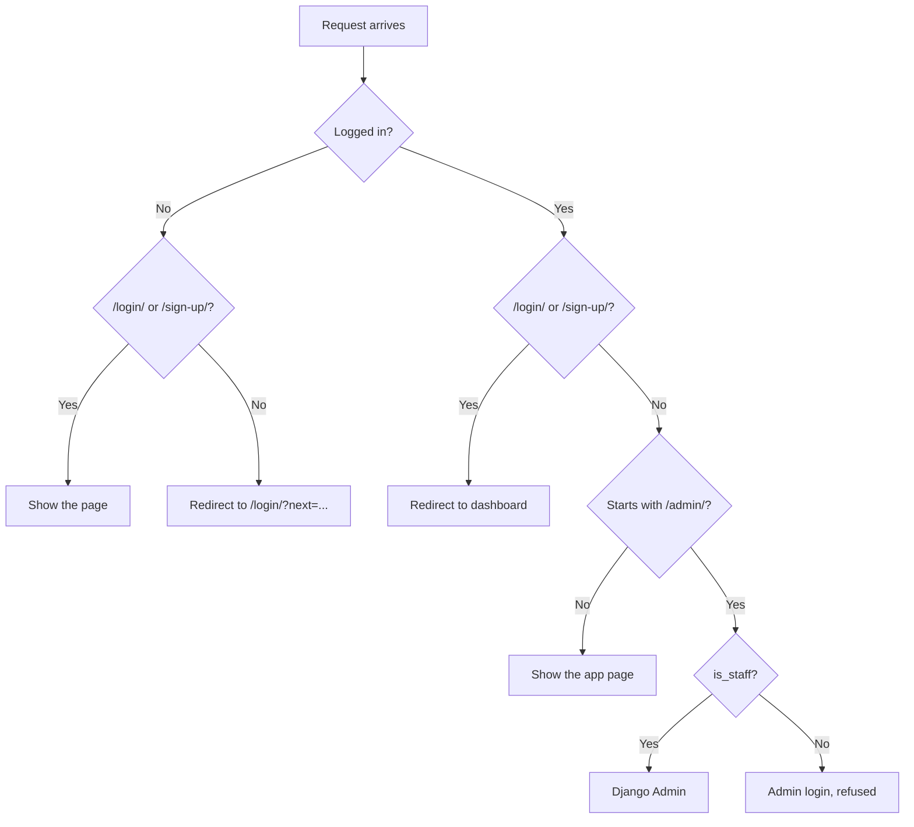
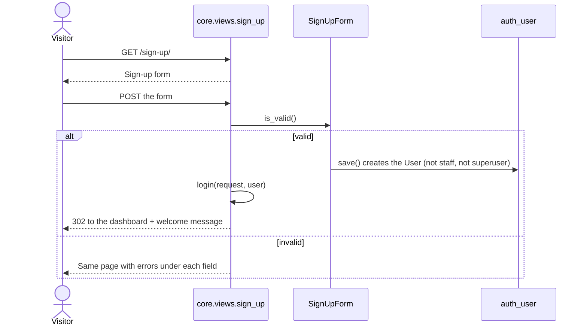

# SACCO Management System

A Django back-office app for the people who run a SACCO (a savings and loans group).
Anyone can sign up for an account or log in. After logging in, they see a dashboard of
live numbers and manage seven kinds of records (members, staff, accounts, savings,
withdrawals, loans and loan payments) with Add, Edit and Delete buttons. Forms open in a
modal on the same page.

A signed-up account is a plain Django user: **not staff and not superuser**. Members of
the SACCO are records in the database and never log in. See
[Sign-up, login and access](#sign-up-login-and-access) for how accounts work.

Django 6.1 and SQLite only. The styling is one hand-written stylesheet, with no
Bootstrap or Tailwind. This is a university class project.

## Group members

| No. | Name | Registration number |
|-----|------|---------------------|
| 1 | Farhan Segujja | 224-063061-29800|
| 2 | Lwanga Najib | 224-063061-30009|
| 3 | Bugembe Mahad | 224-063061-28843|

**Live site:** https://sacco-web-app.onrender.com
**Admin login:** `admin` / `admin123`

## Where the project stands

**The application is built and working.** This repository is now read-only for
contributors: the owner has restricted who can push, so you can clone it, run it and
read it, but changes are made by the owner only.

What is in `main`:

- Sign-up, login and logout. Sign-up and login are for logged-out visitors only: a logged-in
  user who opens them is sent to the dashboard, and no Sign up link appears inside the app.
  Every other page is locked behind a login.
- Django Admin (`/admin/`, with its sidebar link) is for staff only. A new account is not
  staff; a superuser promotes it by ticking *Staff status*. The admin is customised: a
  `ModelAdmin` per model (columns, filters, search), the app's logo and colours, and a
  link back to the app.
- A dashboard with eight live number cards (members, staff, accounts, total savings,
  loans issued, loan repayments, still owed, withdrawals), a small analytics brief and
  two recent-activity tables.
- An **Analytics** page (`/analytics/`) with simple charts drawn in plain HTML and CSS:
  savings per month, member exits per month, how much of the loan book is repaid,
  repayments per month, and savings by payment method.
- Seven record pages, each with a table, a search box, a large **Add** button, and
  pencil and trash icons on every row. Add, Edit and Delete all open in a modal.
  The search matches names and other text, and also codes such as `MEM-007`.
- The views are plain functions with the Create, Read, Update and Delete steps written
  out in each one (no shared class-based views).
- Automatic IDs shown as codes (`MEM-001`, `STF-001`, `ACC-001`, `SAV-001`, `LN-001`,
  `PAY-001`, `WDR-001`). Nobody types an ID.
- Linked data with rules: an account's balance is its opening balance plus its
  savings; a loan's "still owed" is the loan minus its payments; a payment cannot
  exceed what is still owed; deleting a member also deletes their accounts, savings,
  loans and withdrawals.
- A `db.sqlite3` that already contains demo data, so the app has something to show
  the moment it starts: 113 members, 12 staff, 173 accounts, 820 savings, 60 loans,
  180 loan payments and 14 withdrawals. The 113 members carry the names from the class
  list (the first name is the family name as listed); their phone numbers, addresses
  and email addresses are made up (emails end in `@example.com`).
- 203 automated tests, all passing.

Deliberately left out, to keep it a simple class demo: member logins (members are records,
only the people running the SACCO have accounts), password reset by email, email
verification, roles with permissions (a staff "role" is just a label), loan
approval, interest calculation, filters beyond the search box, date-range pickers,
exports, and any REST API.

## Sign-up, login and access

This is how accounts work. The full reasoning and the plan it was built from are in
[`docs/2026-11-14-auth-signup-design.md`](docs/2026-11-14-auth-signup-design.md).

### The idea

- **Who has an account:** the people who run the SACCO. SACCO members and the `Staff`
  records are plain data, not Django users, and there is no member portal.
- **Anyone can sign up** at `/sign-up/` with a username, first name, last name, email and a
  password (typed twice). The password goes through Django's own validators.
- **A new account is not staff and not superuser.** It can use the dashboard, analytics
  and all seven data pages, but not Django Admin.
- **Staff and superuser are only granted in Django Admin.** A superuser opens *Users*,
  picks the account and ticks *Staff status* (and *Superuser status* if wanted).
- **Sign-up never shows while logged in.** The Sign up link exists only on the two logged-out
  pages, and typing `/sign-up/` or `/login/` while logged in redirects to the dashboard.

### What each kind of visitor can open

| Page | Logged out | Signed-up user (not staff) | Staff / superuser |
|---|---|---|---|
| `/login/` | Yes | Redirected to the dashboard | Redirected to the dashboard |
| `/sign-up/` | Yes | Redirected to the dashboard | Redirected to the dashboard |
| Dashboard, analytics, the 7 data pages (add, edit, delete too) | Redirected to `/login/?next=...` | Yes | Yes |
| `/admin/` | Admin login page | Refused (admin login page) | Yes |
| "Django Admin" link in the sidebar | n/a | Hidden | Shown |



### What happens when someone signs up



### Where it lives in the code

| Piece | File | What it does |
|---|---|---|
| Sign-up form | `core/forms.py` (`SignUpForm`) | Django's `UserCreationForm` plus first name, last name and email (all required) |
| Sign-up view | `core/views.py` (`sign_up`) | Redirects logged-in users, saves the user, logs them in, adds the welcome message |
| Routes | `core/urls.py` | `/sign-up/`, and `LoginView(redirect_authenticated_user=True)` for `/login/` |
| Shared layout | `templates/auth_base.html` | Extends `base.html`, replaces the sidebar shell with the centred card and the Log in / Sign up switch |
| Login and sign-up pages | `templates/registration/login.html`, `sign_up.html` | Both extend `auth_base.html` (two levels: `base`, `auth_base`, page) |
| Base template | `templates/base.html` | The sidebar, top bar and content now sit inside a `` that `auth_base.html` overrides |
| Staff-only admin link | `templates/partials/_sidebar.html` | The Django Admin link is wrapped in `` |
| Admin classes | `*/admin.py` (7 models) | `list_display`, `list_filter`, `search_fields` for each model |
| Admin branding | `core/admin.py`, `templates/admin/base_site.html`, `static/css/admin.css` | Site titles, logo, app colours, "Back to the app" link |

No model or migration changed: sign-up uses Django's built-in `User` table as it is.

### How the existing pages are protected

All 30 data and dashboard views keep `@login_required`. There is deliberately no
staff-only gate on them, so every logged-in user can manage the data. That keeps the rule
simple (logged in or not) and means the existing tests, which log in plain users, still
pass. If you later want read-only accounts or an approval step, that is the place to add it.

### Try it

1. Log out, open `/sign-up/`, create an account. You land on the dashboard.
2. Check the sidebar: no Sign up link and no Django Admin link.
3. Open `/sign-up/` and `/login/` by hand: both send you back to the dashboard.
4. Open `/admin/`: you are refused.
5. Log out and log in as `admin` (see the demo login below). The Django Admin link is there.
   Open *Users* and see the new account with *Staff status* unticked.

The tests for all of this are in `core/tests.py` (`SignUpTests`, `AuthLayoutTests`,
`ShellTests`, `AdminCustomisationTests`).

## Run it and see what is there

You need Python (built and tested on 3.13) and Git.

1. Clone the repository and go into the folder.
2. Create and activate a virtual environment:
   ```
   python -m venv venv
   venv\Scripts\activate        # Windows
   source venv/bin/activate     # macOS/Linux
   ```
3. Install the one dependency (Django):
   ```
   pip install -r requirements.txt
   ```
4. Start the server and open `http://127.0.0.1:8000/`:
   ```
   python manage.py runserver
   ```

That is all. The committed `db.sqlite3` already has the tables and the demo data, so
you do **not** need to run `migrate` or `seed`.

### Demo login (throwaway)

| Username | Password |
|---|---|
| `admin` | `sacco-demo-2026` |

This password is for the class demo only. Do not reuse it anywhere.

### What to look at

1. Open `/sign-up/` logged out, create an account, and look at the dashboard (log out and
   check the Sign up link is back on the login page). Use a username other than `admin`.
2. Open **Members** and click a pencil to edit, the trash to delete (it asks first),
   or **Add member** at the top right.
3. Open **Savings**, **Loans** and **Loan payments** to see how the records link
   together, and compare the dashboard numbers afterwards.
4. Log in as `admin` and open **Django Admin** (bottom of the sidebar, staff only) to see the
   same data in Django's own screens, with custom columns, search and branding.

### If the data gets messy

Using the app changes `db.sqlite3` on your machine (including a login session). To
put the committed demo data back:

```
git checkout -- db.sqlite3
```

Only for a brand-new empty database: `python manage.py migrate` then
`python manage.py seed`. That command builds a different, smaller set of random demo
data (60 members, 8 staff, 90 accounts, 300 savings, 25 loans, 70 loan payments and
6 withdrawals) and does **not** recreate the committed 113-member database. Do not run
`seed --reset` on the committed database; it wipes everything, including the class
list, and renumbers the codes from MEM-114 onward.

## Pages and addresses

Every page except login and sign-up requires a login.

| Page | Address |
|---|---|
| Login | `/login/` |
| Sign up | `/sign-up/` |
| Logout (POST, button in the sidebar) | `/logout/` |
| Dashboard | `/` |
| Analytics | `/analytics/` |
| Members | `/members/` |
| Staff | `/staff/` |
| Accounts | `/accounts/` |
| Savings | `/savings/` |
| Withdrawals | `/withdrawals/` |
| Loans | `/loans/` |
| Loan payments | `/loan-payments/` |
| Django Admin | `/admin/` |

Each data page also has `add/`, `<id>/edit/` and `<id>/delete/` addresses under it
(for example `/members/add/`), which return the modal forms.

## Project layout

```
manage.py
core/                 settings, root urls.py, CodedModel, search.py (the search helper), template filter ugx,
                      forms.py (SignUpForm), views.py (sign_up), admin.py (admin site titles)
members/ staff/ accounts/ savings/ withdrawals/ loans/
                      one app per data area: models.py, forms.py, views.py, urls.py, admin.py, tests.py
                      (loans/ holds both Loan and LoanPayment)
dashboard/            dashboard and analytics views, stats.py (the dashboard numbers),
                      analytics.py (the chart numbers), management/commands/seed.py
templates/            base.html, auth_base.html, registration/ (login and sign-up),
                      admin/base_site.html, dashboard/ (index and analytics),
                      partials/ (modal, pagination, search box, charts, sidebar),
                      and one list page per data area (loans/ has loan_list.html and payment_list.html)
static/css/app.css    the app stylesheet (admin.css colours Django Admin)
static/img/           logo.png (sidebar logo and browser tab icon)
static/js/            modal.js (modal forms) and lucide.min.js (icons)
db.sqlite3            the database, with demo data (113 members and linked records)
```

## Where to read more

| File | What it tells you |
|---|---|
| `PRODUCT.md` | Who the app is for and what it must do |
| `docs/2026-11-14-auth-signup-design.md` | The sign-up and access plan: reasoning, diagrams, test plan, demo script |
| `DESIGN.md` | The visual design system as built: palette, type, components |
| `SACCO Script.sql` | The original database script from the first design stage (reference only; the Django models are the source of truth) |

## Running the tests

```
python manage.py test
python manage.py check
```

The tests take a couple of minutes. They use Django's temporary test database and do
not touch `db.sqlite3`.

## Branches and contributing

- `main` is the current, finished state of the project. It is the only branch on the
  remote that matters for reading and running the app.
- `deployment` is the old hosting branch. It is not touched.
- Pushing is restricted to the owner. You can still clone, run, read and fork; if you
  find a problem, tell the owner.

## Known limits

- It uses Django's development settings (`DEBUG = True`, a committed `SECRET_KEY`), so
  it is not ready to be put on the public internet as it stands.
- The Roboto font loads from Google Fonts, so with no internet connection the page
  falls back to a system font. Everything else works offline.
- Sign-up is open and new accounts get full add, edit and delete rights on the data, so
  anyone who can reach the site can change records. Fine for a class demo; not for real money.
- Deleting a staff record also deletes the savings and loans that staff member handled.
  The delete window warns about this.
