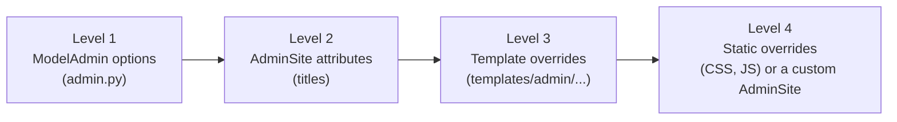
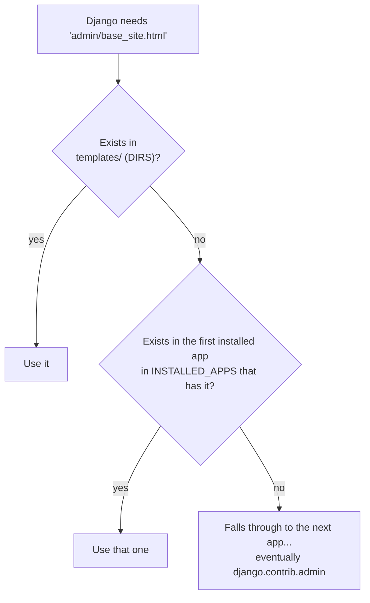

# 1. Django admin fundamentals

> Written for: a junior developer. No prior knowledge of how the admin is built is assumed.

Before using django-unfold or django-jazzmin you need to know how the **plain** Django admin works, because both packages are just clever uses of the mechanisms in this file.

All examples use this SACCO project (Django 6.1).

---

## 1. What the admin actually is

The Django admin is an ordinary Django app, `django.contrib.admin`, that ships inside Django. It generates a back-office website from your models. It has:

| Part | What it is | Where it lives |
|---|---|---|
| **`AdminSite`** | The object that owns the admin: its URLs, its title, which models are registered. The default one is `django.contrib.admin.site`, usually written `admin.site`. | `django/contrib/admin/sites.py` |
| **`ModelAdmin`** | One per model. Says how that model looks in the admin: columns, filters, search, form layout. | `django/contrib/admin/options.py` |
| **Templates** | The HTML for every admin page. | `django/contrib/admin/templates/admin/` |
| **Static files** | The CSS, JavaScript and images. | `django/contrib/admin/static/admin/` |

Find them on your machine with:

```bash
python -c "import django, os; print(os.path.dirname(django.__file__))"
```

Open `contrib/admin/templates/admin/` there and just read. Every customisation in this guide is "change one of these files, or tell Django to use a different one".

### How a model gets into the admin

In `members/admin.py` the project originally had:

```python
from django.contrib import admin
from .models import Member

admin.site.register(Member)
```

`register` adds `Member` to `admin.site`. Because no `ModelAdmin` was given, Django uses a default one: a list with one column (the model's `__str__`), no filters, no search. That is the "bare" admin.

At startup Django runs **autodiscover**: it imports every installed app's `admin.py`, which is what triggers those `register` calls. That is why admin code must live in a file called exactly `admin.py`.

### The URLs you get for free

Each registered model gets these named URLs, which you can use with `reverse()` or ``:

| Page | URL name pattern | Example for `Member` |
|---|---|---|
| List ("change list") | `admin:<app>_<model>_changelist` | `admin:members_member_changelist` → `/admin/members/member/` |
| Add | `admin:<app>_<model>_add` | `/admin/members/member/add/` |
| Edit ("change form") | `admin:<app>_<model>_change` | `/admin/members/member/3/change/` |
| Delete | `admin:<app>_<model>_delete` | `/admin/members/member/3/delete/` |
| History | `admin:<app>_<model>_history` | `/admin/members/member/3/history/` |

Both packages in this guide use these names when you build custom sidebars or menus.

---

## 2. The four native levels of customisation

Climb these in order. Most needs are solved at levels 1 and 2 with **no package at all**.



### Level 1: `ModelAdmin` options (what the admin shows)

This is the code that was written for **both** experiments, because it works the same with or without a theme. Here is `members/admin.py` after the change:

```python
from django.contrib import admin

from .models import Member


@admin.register(Member)
class MemberAdmin(admin.ModelAdmin):
    list_display = ("code", "first_name", "last_name", "contact", "email", "gender")
    list_filter = ("gender",)
    search_fields = ("first_name", "last_name", "contact", "email")
    list_per_page = 15
    ordering = ("-id",)
```

What each line does, and **exactly where you see it**:

| Option | Effect | Where you see it |
|---|---|---|
| `@admin.register(Member)` | Same as `admin.site.register(Member, MemberAdmin)`, but written on the class. | The model appears in the admin. |
| `list_display` | Which columns the list page shows. Entries can be field names, model properties or methods, or methods on the admin class. | The column headings of the table. In this project `"code"` is a *property* on `CodedModel` (`MEM-007`), and properties work here. |
| `list_filter` | Adds a filter panel. Fields with choices (like gender) become a list of choices; dates get "Today / Past 7 days". | The right-hand "Filter" box. |
| `search_fields` | Adds a search box. Each name is searched with a case-insensitive "contains". Use `__` to cross relations. | The search bar above the table. |
| `list_per_page` | Rows per page. Default is 100. | The pager at the bottom. |
| `ordering` | Default sort. `"-id"` means newest first. | Row order. |

Relations work with double underscores. For savings:

```python
search_fields = ("member__first_name", "member__last_name", "account__account_number")
list_select_related = ("member", "account", "staff")
date_hierarchy = "date"
```

| Option | Effect |
|---|---|
| `member__first_name` | Search the related Member's first name. |
| `list_select_related` | Fetches the related rows in the same SQL query. Without it, showing `member` in `list_display` runs one extra query **per row** (the "N+1 problem"). |
| `date_hierarchy = "date"` | Adds a year → month → day drill-down bar above the table. |

Everything above is plain Django. **Both theme packages make these same options look nicer; neither replaces them.**

### Level 2: `AdminSite` attributes (the titles)

Three strings control the headings. Put them in any `admin.py` that loads at startup (for example `core/admin.py`):

```python
from django.contrib import admin

admin.site.site_header = "SACCO Administration"   # the big name at the top left
admin.site.site_title = "SACCO Admin"             # the browser tab title suffix
admin.site.index_title = "Manage the SACCO"       # the heading on the home page
```

They live as class attributes on `AdminSite` (`sites.py` in Django: `site_title`, `site_header`, `index_title`, `site_url`). The themes read the same values, then add their own settings on top.

### Level 3: template overrides (how a page is laid out)

This is the most important idea in the whole guide, because **both packages work purely by providing replacement templates.**

#### Template lookup, step by step

When Django renders `admin/base_site.html` it walks the template loaders in the order set by `TEMPLATES` in `core/settings.py`:

```python
TEMPLATES = [{
    "BACKEND": "django.template.backends.django.DjangoTemplates",
    "DIRS": [BASE_DIR / "templates"],   # 1st: the project's own templates folder
    "APP_DIRS": True,                   # 2nd: each installed app's templates folder, in INSTALLED_APPS order
    ...
}]
```



The first match wins. Two consequences you will use constantly:

1. **Your own `templates/admin/...` always beats everything** (it is searched first).
2. **Order in `INSTALLED_APPS` decides which package wins.** That is why the theme packages must be listed **above** `django.contrib.admin`:

```python
INSTALLED_APPS = [
    "unfold",                    # or "jazzmin": searched BEFORE django.contrib.admin
    "django.contrib.admin",
    "django.contrib.auth",
    ...
]
```

If `unfold` were listed after `django.contrib.admin`, Django would find the stock `admin/base.html` first and the theme would silently do nothing. This is the single most common mistake.

#### Overriding one template yourself

Create a file with the **same path** under your project's `templates/` folder. To change only the heading branding:

```
templates/
  admin/
    base_site.html      <-- your override of django's admin/base_site.html
```

```django


{{ title }} | SACCO


  <h1 id="site-name"><a href="">SACCO Admin</a></h1>



```

`` keeps everything else from Django. You only redefine the ``s you want to change. The blocks Django's `admin/base.html` offers (verified in Django 6.1):

| Block | Page region |
|---|---|
| `title` | the browser tab title |
| `extrastyle`, `extrahead` | where to add your own CSS or `<head>` tags |
| `branding` | the site name at the top left |
| `usertools`, `userlinks`, `welcome-msg` | the "Welcome, admin / Log out" area |
| `nav-global`, `nav-sidebar`, `sidebar` | navigation regions |
| `breadcrumbs`, `nav-breadcrumbs` | the trail under the header |
| `pretitle`, `content_title`, `content_subtitle`, `content` | the page body |
| `messages` | the success / error banners |
| `footer`, `extrabody` | bottom of the page |

The templates worth knowing, all in `django/contrib/admin/templates/admin/`:

| Template | Which page |
|---|---|
| `base.html`, `base_site.html` | The frame around every page |
| `index.html`, `app_index.html`, `app_list.html` | The home page and the model list |
| `change_list.html`, `change_list_results.html`, `pagination.html`, `search_form.html`, `filter.html`, `date_hierarchy.html` | The list page and its parts |
| `change_form.html`, `submit_line.html`, `includes/fieldset.html` | The add/edit form and its parts |
| `delete_confirmation.html` | Delete confirmation |
| `login.html` | The sign-in page |

You can also override per app or per model: Django looks for `admin/members/member/change_list.html` before `admin/members/change_list.html` before `admin/change_list.html`. That lets you restyle only the Member page.

### Level 4: static files and a custom `AdminSite`

**Static override.** Add your own CSS from a template override:

```django


  {{ block.super }}
  <link rel="stylesheet" href="">

```

(`{{ block.super }}` keeps Django's original content of that block.) Put `admin-overrides.css` in the project's `static/css/`. The admin colours are CSS variables defined in `django/contrib/admin/static/admin/css/base.css` (for example `--primary`, `--header-bg`), so a small override file can recolour the admin without touching any template.

**Custom `AdminSite`.** If you need a second, separate admin (for example a read-only one for managers), subclass it:

```python
from django.contrib import admin

class SaccoAdminSite(admin.AdminSite):
    site_header = "SACCO"
    index_template = "admin/sacco_index.html"   # use your own home page template

sacco_admin = SaccoAdminSite(name="sacco_admin")
```

Then register models on `sacco_admin` and mount `sacco_admin.urls` in `core/urls.py`. Both theme packages avoid this: they restyle the one default site.

---

## 3. Where static files come from (and why `STATICFILES_DIRS` matters)

Static files (CSS, JS, images) are found by Django's `staticfiles` app in the same two-step way as templates:

| Source | Setting | In this project |
|---|---|---|
| The project's own folders | `STATICFILES_DIRS` | `[BASE_DIR / "static"]` |
| Each installed app's `static/` folder | `AppDirectoriesFinder` (automatic) | The admin's CSS, plus each theme's CSS |

That is how `static("img/logo.png")` finds the SACCO logo you saved in `static/img/` and how a theme's own CSS gets served with no setup. In development (`DEBUG = True`) `runserver` serves them directly. In production you run `collectstatic` to gather them all into `STATIC_ROOT`.

---

## 4. Summary: which tool for which wish

| You want to... | Use |
|---|---|
| Change columns, filters, search, ordering | `ModelAdmin` options (`admin.py`) |
| Change the site name and titles | `AdminSite` attributes |
| Change how one page is laid out | Override a template in `templates/admin/` |
| Recolour or restyle everything | CSS in `extrastyle`, or a theme package |
| Get a whole modern look in one install | **unfold** or **jazzmin** (files 2 and 3) |

Continue with [02-django-unfold.md](02-django-unfold.md) or [03-django-jazzmin.md](03-django-jazzmin.md).
