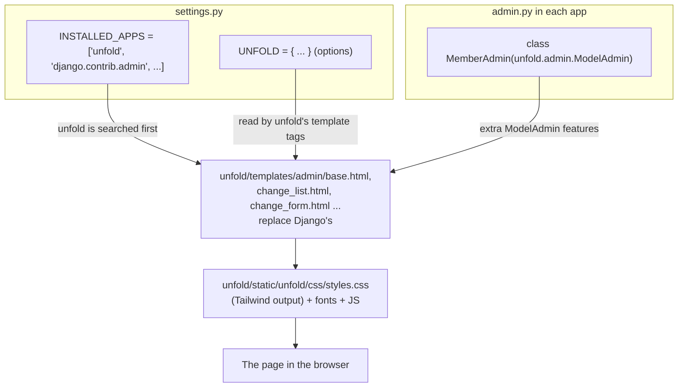

# 2. django-unfold: step by step

> Written for: a junior developer. Read [01-django-admin-fundamentals.md](01-django-admin-fundamentals.md) first.

| | |
|---|---|
| Package | `django-unfold` 0.110.1 (tested with Django 6.1 on Python 3.13) |
| Requires | Python 3.12 or newer, Django 5.2 or newer |
| Built on | Tailwind CSS. Modern, minimal, supports light and dark mode. |
| Experiment branch | `experiment/admin-unfold` (never committed; study only) |
| Where it ran | http://127.0.0.1:8001/admin/ with `admin` / `sacco-demo-2026` |

## 1. How unfold works, in one picture

Unfold does **not** patch Django. It ships its own copies of nearly every admin template and its own CSS, and relies on the template lookup rule from file 1 ("first match wins, in `INSTALLED_APPS` order") to make Django use them.



## 2. Installing

Normal installation, in your virtual environment:

```bash
pip install django-unfold
```

and add `django-unfold` to `requirements.txt`. (In the experiment it was installed into a throwaway folder instead; see the README in this folder.)

## 3. The code changes, file by file

Five kinds of file changed. Everything below was executed and verified: every admin page I opened (`/admin/`, member list, member edit form, savings list, loans list, users list, a search) returned HTTP 200 and contained unfold markup.

### 3.1 `core/settings.py`: switch it on

**Change 1: add `unfold` to `INSTALLED_APPS`, above `django.contrib.admin`.**

```python
INSTALLED_APPS = [
    'unfold',  # must come BEFORE django.contrib.admin so its templates win
    'django.contrib.admin',
    'django.contrib.auth',
    ...
]
```

*Why above?* Template lookup order (file 1, section 2). Put it below and the stock admin wins and nothing changes.

**Change 2: add an `UNFOLD` dictionary at the bottom of the file.** All keys are optional; anything you omit uses unfold's default (defaults live in `unfold/settings.py` in the package, a good file to read).

```python
from django.templatetags.static import static
from django.urls import reverse_lazy

UNFOLD = {
    "SITE_TITLE": "SACCO Admin",
    "SITE_HEADER": "SACCO",
    "SITE_SUBHEADER": "Management",
    "SITE_URL": "/",
    "SITE_ICON": lambda request: static("img/logo.png"),
    "SITE_LOGO": lambda request: static("img/logo.png"),
    "SITE_FAVICONS": [
        {"rel": "icon", "sizes": "512x512", "type": "image/png",
         "href": lambda request: static("img/logo.png")},
    ],
    "SHOW_HISTORY": True,
    "SHOW_VIEW_ON_SITE": True,
    "COLORS": {
        "primary": {
            "50": "oklch(98% .016 73.684)",
            ...                                   # 50 through 950, an orange scale
            "950": "oklch(26.6% .079 36.259)",
        },
    },
    "SIDEBAR": {
        "show_search": True,
        "show_all_applications": False,
        "navigation": [ ... ],                    # see below
    },
}
```

What each key changes:

| Key | What you see change |
|---|---|
| `SITE_TITLE` | Browser tab title suffix. |
| `SITE_HEADER` / `SITE_SUBHEADER` | The name and sub-line at the top of the sidebar. |
| `SITE_URL` | Where clicking the brand goes (`/` = the SACCO app dashboard). |
| `SITE_ICON` / `SITE_LOGO` | The logo image in the sidebar and on the login page. A **function** taking `request` and returning a URL (that is why `lambda request: static(...)`). `static("img/logo.png")` resolves to the logo in the project's own `static/img/` folder through `STATICFILES_DIRS`. |
| `SITE_FAVICONS` | The browser tab icon, as a list of `<link rel="icon">` entries. |
| `SHOW_HISTORY` / `SHOW_VIEW_ON_SITE` | Show the History and "View on site" buttons on edit pages. |
| `COLORS.primary` | The accent colour used on buttons, links, focus rings, active menu items. A 50-950 scale of `oklch(...)` colours. The orange values above are the standard Tailwind orange scale so the admin matches the SACCO app's orange. Unfold also lets you change `base` (the greys) and `font`. |
| `SIDEBAR.show_search` | The search box at the top of the sidebar that filters menu items. |
| `SIDEBAR.show_all_applications` | Whether to add an automatic list of every app and model. |
| `SIDEBAR.navigation` | A hand-built menu (below). When present, it replaces the automatic one. |

**The sidebar navigation** is a list of groups; each group has `items`. Icons are names from the **Material Symbols** font (`group`, `savings`, `payments` ...). `link` is the target URL; `reverse_lazy` is used because URLs cannot be looked up while settings are still loading ("lazy" delays the lookup until first use):

```python
"navigation": [
    {
        "title": "SACCO",
        "separator": True,
        "items": [
            {"title": "Back to the app", "icon": "home", "link": reverse_lazy("dashboard")},
            {"title": "Members", "icon": "group", "link": reverse_lazy("admin:members_member_changelist")},
            {"title": "Staff", "icon": "badge", "link": reverse_lazy("admin:staff_staff_changelist")},
            {"title": "Accounts", "icon": "account_balance_wallet", "link": reverse_lazy("admin:accounts_account_changelist")},
            {"title": "Savings", "icon": "savings", "link": reverse_lazy("admin:savings_saving_changelist")},
            {"title": "Withdrawals", "icon": "logout", "link": reverse_lazy("admin:withdrawals_withdrawal_changelist")},
            {"title": "Loans", "icon": "payments", "link": reverse_lazy("admin:loans_loan_changelist")},
            {"title": "Loan payments", "icon": "credit_card", "link": reverse_lazy("admin:loans_loanpayment_changelist")},
        ],
    },
    {
        "title": "Administration",
        "separator": True,
        "items": [
            {"title": "Users", "icon": "person", "link": reverse_lazy("admin:auth_user_changelist")},
        ],
    },
],
```

Notice the URL names are exactly the pattern from file 1: `admin:<app>_<model>_changelist`.

### 3.2 Each app's `admin.py`: inherit from unfold's `ModelAdmin`

The only difference from the native version in file 1 is **which class you inherit from**:

```python
from django.contrib import admin
from unfold.admin import ModelAdmin          # <-- new import

from .models import Member


@admin.register(Member)
class MemberAdmin(ModelAdmin):               # <-- unfold's ModelAdmin, not admin.ModelAdmin
    list_display = ("code", "first_name", "last_name", "contact", "email", "gender")
    list_filter = ("gender",)
    search_fields = ("first_name", "last_name", "contact", "email")
    list_per_page = 15
    ordering = ("-id",)
```

`unfold.admin.ModelAdmin` **is** a Django `ModelAdmin` with extra abilities (listed in section 5). If you keep using plain `admin.ModelAdmin`, the page still gets unfold's frame and colours, but forms, filters and widgets are not fully styled. The same pattern was applied to all seven models (Member, Staff, Account, Saving, Withdrawal, Loan, LoanPayment).

### 3.3 New file `core/admin.py`: restyle the built-in User and Group admins

Django's own **User** and **Group** admins are registered by `django.contrib.auth` with the plain `ModelAdmin`, so unfold would leave their forms unstyled. The fix is to unregister them and register versions that mix in unfold:

```python
from django.contrib import admin
from django.contrib.auth.admin import GroupAdmin as BaseGroupAdmin
from django.contrib.auth.admin import UserAdmin as BaseUserAdmin
from django.contrib.auth.models import Group, User
from unfold.admin import ModelAdmin
from unfold.forms import AdminPasswordChangeForm, UserChangeForm, UserCreationForm

admin.site.unregister(User)
admin.site.unregister(Group)


@admin.register(User)
class UserAdmin(BaseUserAdmin, ModelAdmin):
    form = UserChangeForm
    add_form = UserCreationForm
    change_password_form = AdminPasswordChangeForm


@admin.register(Group)
class GroupAdmin(BaseGroupAdmin, ModelAdmin):
    pass
```

*Why `core`?* `core` is an installed app, so Django's autodiscover imports its `admin.py`. The file was new because `core` had none.

*Why two parents?* `BaseUserAdmin` keeps Django's user logic (password fields, permissions fieldsets). `ModelAdmin` (unfold's) adds the look. The unfold `forms` swap in styled versions of the three user forms.

### 3.4 No template or static changes were needed

Notice what did **not** change: no file under `templates/` and nothing under `static/` other than reusing the existing logo. Unfold's own templates and CSS inside the installed package do all the work. That is the benefit of a theme package.

## 4. What changes on screen, and where it comes from

| What you see | Where the change comes from |
|---|---|
| New frame: sidebar on the left, no top bar clutter | `unfold/templates/admin/base.html`, `base_site.html`, `nav_sidebar.html` replaced Django's |
| SACCO logo and name in the sidebar | `SITE_LOGO`, `SITE_HEADER`, `SITE_SUBHEADER` in `UNFOLD` |
| Orange accents | `UNFOLD["COLORS"]["primary"]` |
| Custom menu with icons | `UNFOLD["SIDEBAR"]["navigation"]` |
| Rounded, spaced tables with a filter panel and a search box | `unfold/templates/admin/change_list.html`, `change_list_results.html`, `search_form.html`, `filter.html` |
| Styled edit form | `unfold/templates/admin/change_form.html`, `includes/fieldset.html`, `submit_line.html` |
| Styled login page | `unfold/templates/admin/login.html` |
| Light/dark switch | built in; follows the system or the toggle |
| Which columns, filters, search | **Not unfold.** Your `ModelAdmin` options. |

Browse `unfold/templates/admin/` inside the installed package to see all the replaced templates (actions, app_index, app_list, base, change_form, change_list, delete_confirmation, filter, index, login, pagination, search_form, submit_line and more) plus `unfold/components/` (reusable cards, charts, tables) and `unfold/helpers/` (small pieces like badges and avatars).

## 5. Things unfold adds that you can try next

None of these were applied in the experiment; they are the natural next steps.

| Feature | How |
|---|---|
| A dashboard on the admin home page | Set `UNFOLD["DASHBOARD_CALLBACK"]` to a function that adds data to the context, and override `templates/admin/index.html` using unfold's `unfold/components/` cards and charts. |
| Coloured status badges in a column | Decorate a method with `@display(label={...})` from `unfold.decorators`, then use it in `list_display`. |
| Nicer filters (dropdown, date range, numeric range) | `from unfold.contrib.filters.admin import ...` and add `"unfold.contrib.filters"` to `INSTALLED_APPS`. |
| Tabs on the list page | `UNFOLD["TABS"]`. |
| Filters in a side sheet or a "submit" button | `ModelAdmin` options `list_filter_sheet` (on by default) and `list_filter_submit`. |
| Full-width tables | `list_fullwidth = True`. |
| Warn about unsaved edits | `warn_unsaved_form = True`. |
| Row actions | the `@action` decorator from `unfold.decorators`. |

## 6. Gotchas

| Problem | Cause and fix |
|---|---|
| Nothing changes after installing | `unfold` is below `django.contrib.admin` in `INSTALLED_APPS`. Move it above. |
| User and Group pages look unstyled | You did not re-register them (section 3.3). |
| `ImportError: ... Python 3.12` | Unfold needs Python 3.12+. |
| Old CSS still showing | Hard-refresh (Ctrl+F5). In production run `collectstatic`. |
| `NoReverseMatch` in the sidebar | The URL name is wrong. Check the pattern `admin:<app>_<model>_changelist`. |
| Colours look odd | `COLORS` values must be valid CSS colours; unfold uses `oklch(...)`. |

## 7. Undoing it

Because the experiment was never committed, throw it away with the commands in this folder's README. In a real project you would remove `unfold` from `INSTALLED_APPS`, delete the `UNFOLD` dict, switch `ModelAdmin` imports back to `django.contrib.admin`, and delete the new `core/admin.py`.
