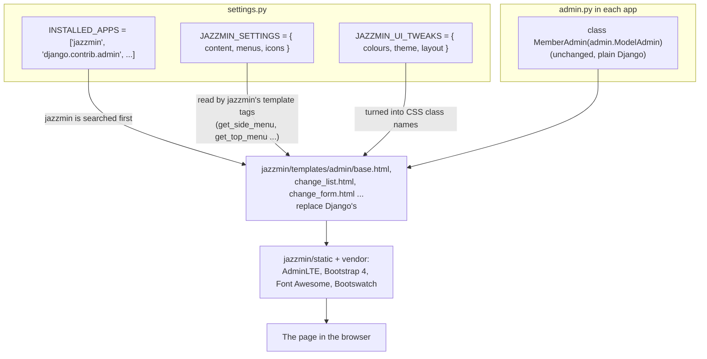

# 3. django-jazzmin: step by step

> Written for: a junior developer. Read [01-django-admin-fundamentals.md](01-django-admin-fundamentals.md) first.

| | |
|---|---|
| Package | `django-jazzmin` 3.0.5 (tested with Django 6.1 on Python 3.13) |
| Requires | Python 3.10 or newer, Django 4.2 or newer |
| Built on | AdminLTE 3 and Bootstrap 4, plus Font Awesome icons and Bootswatch themes |
| Experiment branch | `experiment/admin-jazzmin` (never committed; study only), in the separate folder `sacco-web-app-jazzmin` |
| Where it ran | http://127.0.0.1:8002/admin/ with `admin` / `sacco-demo-2026` |

## 1. How jazzmin works, in one picture

Like unfold, jazzmin replaces Django's admin templates by sitting **above** `django.contrib.admin` in `INSTALLED_APPS`. The big difference is its configuration style: **two plain dictionaries in `settings.py`** and **no change to your `ModelAdmin` classes**.



## 2. Installing

Normal installation, in your virtual environment:

```bash
pip install django-jazzmin
```

and add `django-jazzmin` to `requirements.txt`. (In the experiment it was installed into a throwaway folder instead; see this folder's README.)

## 3. The code changes, file by file

Every admin page tried (`/admin/`, member list, member edit form, savings list, loans list, users list, a search) returned HTTP 200 and contained jazzmin markup.

### 3.1 `core/settings.py`: switch it on

**Change 1: add `jazzmin` to `INSTALLED_APPS`, above `django.contrib.admin`.**

```python
INSTALLED_APPS = [
    'jazzmin',  # must come BEFORE django.contrib.admin so its templates win
    'django.contrib.admin',
    'django.contrib.auth',
    ...
]
```

Same reason as unfold: first match wins in template lookup.

**Change 2: `JAZZMIN_SETTINGS`** (content and layout). Added at the bottom of the file:

```python
JAZZMIN_SETTINGS = {
    "site_title": "SACCO Admin",
    "site_header": "SACCO",
    "site_brand": "SACCO Management",
    "site_logo": "img/logo.png",
    "login_logo": "img/logo.png",
    "site_icon": "img/logo.png",
    "welcome_sign": "Welcome to the SACCO admin",
    "copyright": "SACCO Management",
    "search_model": ["members.Member", "accounts.Account"],
    "topmenu_links": [
        {"name": "Back to the app", "url": "/", "new_window": False},
        {"model": "auth.User"},
    ],
    "usermenu_links": [
        {"name": "SACCO dashboard", "url": "/", "new_window": False},
    ],
    "show_sidebar": True,
    "navigation_expanded": True,
    "order_with_respect_to": [
        "members", "staff", "accounts", "savings", "withdrawals", "loans", "auth",
    ],
    "icons": {
        "auth": "fas fa-users-cog",
        "auth.user": "fas fa-user",
        "auth.Group": "fas fa-users",
        "members.Member": "fas fa-users",
        "staff.Staff": "fas fa-briefcase",
        "accounts.Account": "fas fa-wallet",
        "savings.Saving": "fas fa-coins",
        "withdrawals.Withdrawal": "fas fa-sign-out-alt",
        "loans.Loan": "fas fa-money-bill-wave",
        "loans.LoanPayment": "fas fa-credit-card",
    },
    "default_icon_parents": "fas fa-chevron-circle-right",
    "default_icon_children": "fas fa-circle",
    "related_modal_active": True,
    "changeform_format": "horizontal_tabs",
}
```

What each key does and what you see change:

| Key | Effect |
|---|---|
| `site_title` | Browser tab title suffix. |
| `site_header` | Heading on the login page and the top of the home page. |
| `site_brand` | The name shown next to the logo at the top of the sidebar. |
| `site_logo`, `login_logo` | Logo images. These are **plain static paths** (no function needed, unlike unfold), found through `STATICFILES_DIRS`, so `img/logo.png` is the SACCO logo in the project's `static/img/`. |
| `site_icon` | The favicon in the browser tab. |
| `welcome_sign`, `copyright` | The text on the login page and in the footer. |
| `search_model` | Adds a search box in the top bar that searches these models (it uses each model's `search_fields`). Format `"app_label.ModelName"`. |
| `topmenu_links` | Links in the top navigation bar. Either `{"name", "url"}` for any URL, or `{"model": "auth.User"}` for a model's list page. |
| `usermenu_links` | Extra entries in the dropdown under the user's name. |
| `show_sidebar`, `navigation_expanded` | Whether the left menu exists, and whether the app groups start open. |
| `order_with_respect_to` | The order of apps and models in the sidebar. Names are app labels or `app.Model`. Anything not listed comes after, alphabetically. |
| `icons` | A Font Awesome 5 class per app or model. Keys are `app` or `app.Model`. Unlisted ones get the defaults below. |
| `default_icon_parents`, `default_icon_children` | The fallback icon for an app group and for a model entry. |
| `related_modal_active` | Editing or adding a related object (the "+" next to a foreign key field) opens in a pop-up window on the same page instead of a new browser window. |
| `changeform_format` | How the edit form is laid out: `single`, `horizontal_tabs`, `vertical_tabs`, `collapsible` or `carousel`. |

Other keys exist that were not used here, for example `hide_apps`, `hide_models`, `custom_links` (add menu links under an app), `custom_css` and `custom_js` (load your own files), `show_ui_builder` (show a live theme builder), `user_avatar` and `language_chooser`. The full list of keys and their defaults is in `jazzmin/settings.py` inside the installed package; read it.

**Change 3: `JAZZMIN_UI_TWEAKS`** (looks). Also at the bottom of `settings.py`:

```python
JAZZMIN_UI_TWEAKS = {
    "navbar_small_text": False,
    "footer_small_text": False,
    "body_small_text": False,
    "brand_small_text": False,
    "brand_colour": "navbar-dark",
    "accent": "accent-warning",
    "navbar": "navbar-dark",
    "no_navbar_border": True,
    "sidebar": "sidebar-dark-warning",
    "sidebar_nav_flat_style": True,
    "theme": "default",
    "button_classes": {
        "primary": "btn-warning",
        "secondary": "btn-secondary",
        "info": "btn-info",
        "warning": "btn-warning",
        "danger": "btn-danger",
        "success": "btn-success",
    },
}
```

These values are not magic: they are **Bootstrap and AdminLTE CSS class names**. Jazzmin simply adds them to the right HTML elements.

| Key | Effect |
|---|---|
| `theme` | A Bootswatch theme for the whole look. Options include `default`, `flatly`, `cosmo`, `lumen`, `minty`, `sandstone`, `united`, and dark ones such as `darkly`, `cyborg`, `slate`, `solar`, `superhero`, `vapor`. |
| `sidebar` | Sidebar colour class. `sidebar-dark-warning` is a dark sidebar whose active item is highlighted in Bootstrap's "warning" colour, which is amber/orange. |
| `accent` | The accent colour for links and focus. `accent-warning` = orange. |
| `navbar`, `brand_colour` | Top bar and brand block colour classes. |
| `no_navbar_border` | Drops the line under the top bar. |
| `sidebar_nav_flat_style` | A flatter menu style (other options: `sidebar_nav_compact_style`, `sidebar_nav_legacy_style`, `sidebar_nav_child_indent`). |
| `*_small_text` | Shrinks the font in that region when `True`. |
| `button_classes` | Which Bootstrap button style each kind of button uses. Here primary buttons use `btn-warning` (orange). |

Orange is **not** pixel-matched to the SACCO orange, because jazzmin colours come from Bootstrap's fixed palette. For an exact brand colour you would use the `custom_css` setting (section 5).

### 3.2 `admin.py` files: unchanged from native Django

Jazzmin needs **no change** to your admin classes. The files from file 1 were used as they are, inheriting the normal `admin.ModelAdmin`:

```python
from django.contrib import admin

from .models import Member


@admin.register(Member)
class MemberAdmin(admin.ModelAdmin):
    list_display = ("code", "first_name", "last_name", "contact", "email", "gender")
    list_filter = ("gender",)
    search_fields = ("first_name", "last_name", "contact", "email")
    list_per_page = 15
    ordering = ("-id",)
```

The same shape was applied to all seven models. Jazzmin simply restyles whatever Django renders. This is the biggest practical difference from unfold: **jazzmin never touches your Python admin code.**

### 3.3 No `core/admin.py`, templates or static changes

Unlike unfold, the User and Group pages needed no re-registration, because jazzmin does not rely on a special `ModelAdmin` class. And no file under `templates/` or `static/` was added: the logo reuses `static/img/logo.png`, and everything else is inside the installed package.

## 4. What changes on screen, and where it comes from

| What you see | Where the change comes from |
|---|---|
| New frame: dark sidebar, top bar | `jazzmin/templates/admin/base.html` replaced Django's, loading AdminLTE |
| SACCO logo, name and favicon | `site_logo`, `site_brand`, `site_icon` in `JAZZMIN_SETTINGS` |
| Sidebar with icons, in your order | `order_with_respect_to` and `icons`; the menu is built by the template tag `get_side_menu` in `jazzmin/templatetags/jazzmin.py` |
| Top bar links and the user dropdown | `topmenu_links`, `usermenu_links` (tags `get_top_menu`, `get_user_menu`) |
| Search box in the top bar | `search_model` |
| Orange highlights and buttons | `sidebar`, `accent`, `button_classes` in `JAZZMIN_UI_TWEAKS` |
| Edit forms in tabs | `changeform_format` plus `jazzmin/includes/horizontal_tabs.html` |
| Pop-up for related objects | `related_modal_active` |
| Which columns, filters, search | **Not jazzmin.** Your `ModelAdmin` options. |

Jazzmin's templates are in `jazzmin/templates/admin/` inside the installed package. Compare them with Django's list in file 1: it replaces actions, app_index, base, base_site, change_form, change_list, change_list_results, date_hierarchy, delete_confirmation, filter, index, login, pagination, search_form, submit_line and more. It also ships templates for third-party admin extras (`import_export`, `filer`, `mptt`, `solo`), so those look consistent if you use them.

Its static files, in `jazzmin/static/`, include `jazzmin/css/main.css` and a `vendor/` folder holding `adminlte`, `bootstrap`, `bootswatch` (every theme), `fontawesome-free` and `select2`.

## 5. Things jazzmin lets you try next

| Feature | How |
|---|---|
| Live theme builder | `"show_ui_builder": True` in `JAZZMIN_SETTINGS` adds a panel to try colours and themes in the browser and copy the resulting `JAZZMIN_UI_TWEAKS`. Turn it off afterwards. |
| An exact brand colour | Add `"custom_css": "css/admin-brand.css"` and put that file in `static/css/`. Override Bootstrap or AdminLTE variables there. |
| A different look entirely | Change `theme` (for example `"flatly"` or `"darkly"`). |
| Different form layout per model | `changeform_format_overrides = {"members.member": "vertical_tabs"}`. |
| Hide things | `hide_apps` and `hide_models` lists. |
| Extra menu links under an app | `custom_links`. |

## 6. Gotchas

| Problem | Cause and fix |
|---|---|
| Nothing changes after installing | `jazzmin` is below `django.contrib.admin` in `INSTALLED_APPS`. Move it above. |
| Logo or favicon missing | `site_logo` must be a path **relative to a static folder** (`img/logo.png`), not a URL or a filesystem path. |
| A colour will not match your brand | Jazzmin's colours are Bootstrap's. Use `custom_css`. |
| A model has no icon | Add it to `icons`, or accept the `default_icon_children`. |
| Settings typo has no effect | An unknown key is silently ignored. Check spelling against `jazzmin/settings.py`. |

## 7. Undoing it

The experiment was never committed, so discard it with the commands in this folder's README. In a real project remove `jazzmin` from `INSTALLED_APPS` and delete the two dictionaries. Nothing else needs to change, because your `admin.py` files never knew about jazzmin.
