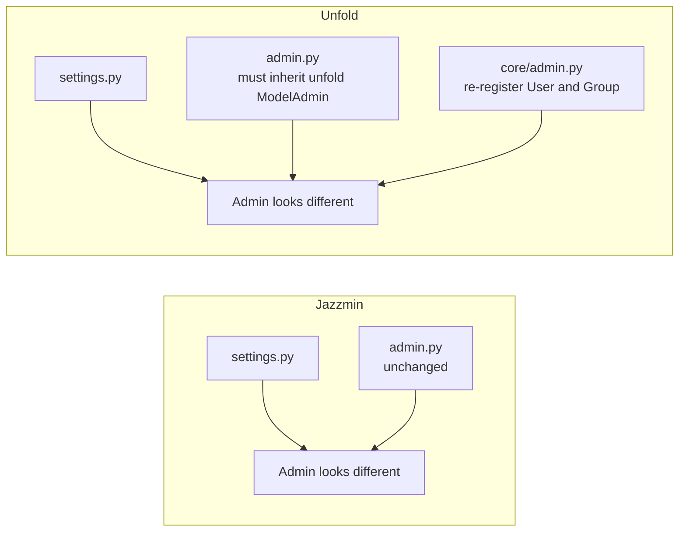

# 4. django-unfold vs django-jazzmin, and how to choose

> Written for: a junior developer deciding whether to adopt a theme package.

Both were installed on this project and every admin page tried rendered correctly. This file compares the **mechanics** of the two (what you write, where, how it can break). For the **look**, open both running admins side by side (README: ports 8001 and 8002) and judge with your own eyes.

## 1. Side by side

| | **django-unfold** | **django-jazzmin** |
|---|---|---|
| Version tested | 0.110.1 | 3.0.5 |
| Needs | Python 3.12+, Django 5.2+ | Python 3.10+, Django 4.2+ |
| Front-end base | Tailwind CSS | AdminLTE 3 and Bootstrap 4 |
| Icons | Material Symbols names (`savings`) | Font Awesome 5 classes (`fas fa-coins`) |
| Light and dark mode | Built in | Via Bootswatch themes (`darkly`, `cyborg`...) and settings |
| Switched on by | `"unfold"` above `django.contrib.admin` | `"jazzmin"` above `django.contrib.admin` |
| Configured by | one dict: `UNFOLD = {...}` | two dicts: `JAZZMIN_SETTINGS` and `JAZZMIN_UI_TWEAKS` |
| Colour control | An exact scale of `oklch(...)` colours; any brand colour works | Bootstrap's fixed palette via class names; exact colours need `custom_css` |
| Logo setting | A **function** returning a URL (`lambda request: static(...)`) | A **static path string** (`"img/logo.png"`) |
| Sidebar menu | `SIDEBAR["navigation"]`, URLs via `reverse_lazy("admin:...")` | Automatic from your apps; reorder with `order_with_respect_to`, add links with `custom_links` |
| Your `admin.py` classes | **Must change**: inherit from `unfold.admin.ModelAdmin` | **No change**: plain `admin.ModelAdmin` |
| User and Group admins | Must be unregistered and re-registered (new `core/admin.py`) | Work as they are |
| Files changed on the experiment branch | `core/settings.py`, 6 `admin.py` files (7 models), new `core/admin.py` | `core/settings.py`, 6 `admin.py` files (7 models, same content as unfold's but with the plain base class) |
| Extra features beyond restyling | Dashboard components, display badges, advanced filters, tabs, row actions, many `ModelAdmin` options | Live UI builder, theme chooser, top-bar and user-menu links, related-object modals, form layouts (tabs, carousel, collapsible) |

## 2. The key difference in one sentence

**Jazzmin restyles the admin from the outside (settings only); unfold restyles it from the inside (settings plus a new `ModelAdmin` base class).**

## 3. What this means for adoption and removal

| Question | Jazzmin | Unfold |
|---|---|---|
| How risky is trying it? | Very low. Add the app and two dicts. | Low, but you touch every `admin.py`. |
| How easy to remove later? | Delete the app and the dicts. Nothing else knew about it. | Remove the app and dict, then switch each `ModelAdmin` back and delete `core/admin.py`. |
| Does it lock in your code? | Almost not at all. | A little: unfold-only options in `ModelAdmin` stop working elsewhere. |
| Matching an existing brand | Approximate unless you add CSS. | Exact through `COLORS`. |

## 4. Recommendation for this project

This project is a small university demo that values simplicity and has an orange brand, a navy sidebar and an "S" logo in the main app.

- **If you want to change as little code as possible and keep the option to undo it instantly: choose jazzmin.** It never touches your Python admin code, and you can recolour the final 10% with one CSS file.
- **If you want the closest visual match to the SACCO app and a modern feel, and do not mind that Python 3.12+ is required: choose unfold.** Its exact colour scale lets the admin share the app's orange, and it gives you more room to grow (filters, badges, dashboards).
- **If the real goal is "the admin should be usable, not pretty": use neither.** Level 1 in file 1 (`list_display`, `list_filter`, `search_fields`) is already applied in both experiments and gives most of the practical benefit. It works on the stock admin with no package at all.

## 5. Practical tips whichever you pick

1. **Keep the `ModelAdmin` options (file 1, level 1).** They matter more than the theme.
2. **Pin the version** in `requirements.txt` (for example `django-unfold==0.110.1`). Theme packages change their internals between releases.
3. **Check Django compatibility** before you upgrade Django. A theme replaces many admin templates, so a Django upgrade can break them until the package catches up.
4. **Hard-refresh** (Ctrl+F5) after changes. Browsers cache admin CSS aggressively.
5. **Do not edit files inside the installed package.** To change something, copy that template into your project's `templates/admin/` folder (it wins by lookup order) or use the package's own setting.
6. **Run `collectstatic` in production** so the theme's CSS, fonts and JavaScript get served.
7. **The admin is for staff.** Neither package makes it a good place for customer-facing features. Those belong in the SACCO app itself.

## 6. A learning exercise

Open both running admins and try the same task in each:

1. Go to the members list and search for `sarah`.
2. Open one member and look at how the form is laid out.
3. Open Savings and use the date filter and the date drill-down.
4. Find the logo and the menu in each.
5. Then open `core/settings.py` in each folder and find **which setting** controls what you just looked at.

Doing that once teaches the central skill: *every visible change maps to one setting, one `admin.py` option, one template, or one static file.* That is the idea running through all four files of this guide.
