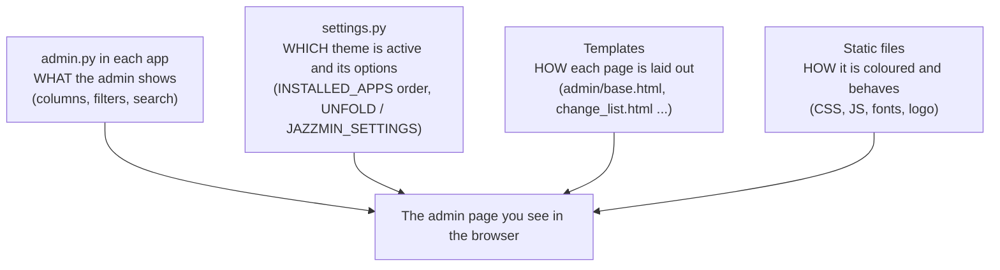

# Django Admin Customisation: a junior developer's guide

> Written for: a junior developer learning how the Django admin is styled and customised, using this SACCO project as the worked example.

This folder teaches you **what** changes when you customise the Django admin, **where** each change lives in the project, and **why** it works. Two real experiments were run on this project so every explanation is backed by code that was actually executed.

## Reading order

| # | File | What you learn |
|---|---|---|
| 1 | [01-django-admin-fundamentals.md](01-django-admin-fundamentals.md) | How the admin works with no extra packages: `AdminSite`, `ModelAdmin`, template lookup, static files, and the four native levels of customisation |
| 2 | [02-django-unfold.md](02-django-unfold.md) | Installing and configuring **django-unfold**, step by step, with every file changed |
| 3 | [03-django-jazzmin.md](03-django-jazzmin.md) | Installing and configuring **django-jazzmin**, step by step, with every file changed |
| 4 | [04-comparison-and-choosing.md](04-comparison-and-choosing.md) | The two side by side, and how to decide |

Read file 1 first. Files 2 and 3 assume you know its vocabulary.

## The experiments (study only, never committed)

Both experiments were built on throwaway branches that were **deliberately not committed**. They exist only as uncommitted changes in a working folder, so you can look at them and then throw them away.

| Branch | Package | Where it lives on disk | URL while running | 
|---|---|---|---|
| `experiment/admin-unfold` | django-unfold 0.110.1 | the project folder `sacco-web-app` | http://127.0.0.1:8001/admin/ |
| `experiment/admin-jazzmin` | django-jazzmin 3.0.5 | a second folder `sacco-web-app-jazzmin` (a git *worktree*) | http://127.0.0.1:8002/admin/ |

Log in with the demo administrator from the README: username `admin`, password `sacco-demo-2026`.

**Why a second folder?** A git repository can only have one branch checked out per folder. `git worktree add` gives a branch its own folder that shares the same `.git` history, so both styled admins can run at the same time and be compared.

**Why the packages are not in `requirements.txt`:** because these are experiments, the two packages were installed into isolated folders outside the project (using `pip install --target`) and made visible to Python through the `PYTHONPATH` environment variable only when the servers started. Nothing was installed into your global Python and `requirements.txt` was never touched. File 2 and file 3 each show the normal way to install (`pip install ...` into your virtual environment) for when you adopt one.

## Running an experiment yourself

```bash
# from the project folder, with the unfold branch checked out
export PYTHONPATH="<folder where you installed django-unfold>"
python manage.py runserver 8001
```

```bash
# from the jazzmin folder
export PYTHONPATH="<folder where you installed django-jazzmin>"
python manage.py runserver 8002
```

If you installed normally with `pip install django-unfold` into your environment, you do not need `PYTHONPATH` at all.

To stop the servers, press Ctrl+C in their terminals (or stop the `python manage.py runserver` processes).

## Cleaning up when you have finished studying

```bash
# remove the second folder and its branch
git worktree remove ../sacco-web-app-jazzmin --force
git branch -D experiment/admin-jazzmin

# throw away the uncommitted unfold changes and go back to main
git restore .
git clean -fd          # removes the new untracked file core/admin.py
git checkout main
git branch -D experiment/admin-unfold
```

`--force`, `git restore .` and `git clean -fd` discard uncommitted work permanently. That is the point here, but read each line before you run it.

## One-page mental model



Every admin customisation falls into one of those four boxes. When something looks wrong, ask which box it belongs to and you will know which file to open.
