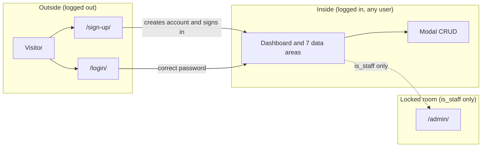
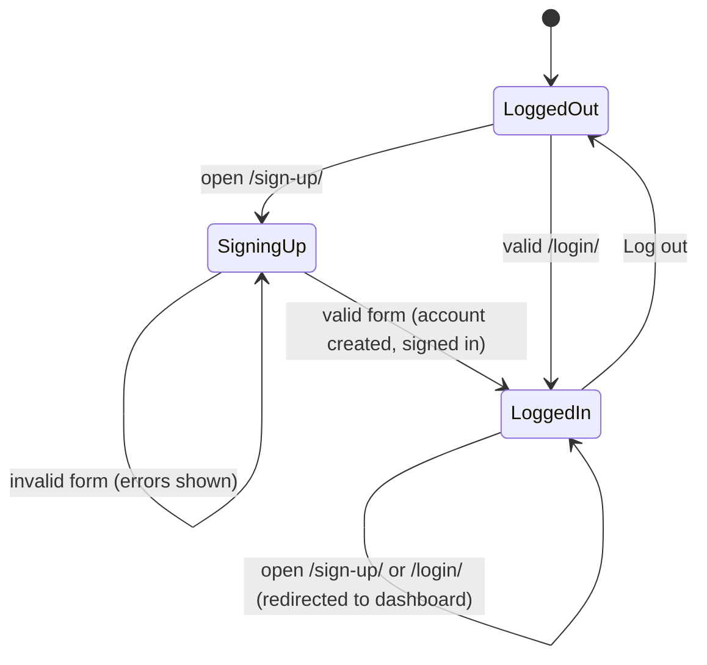
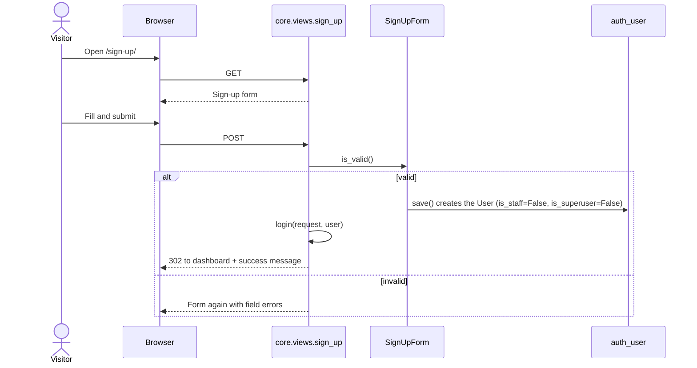
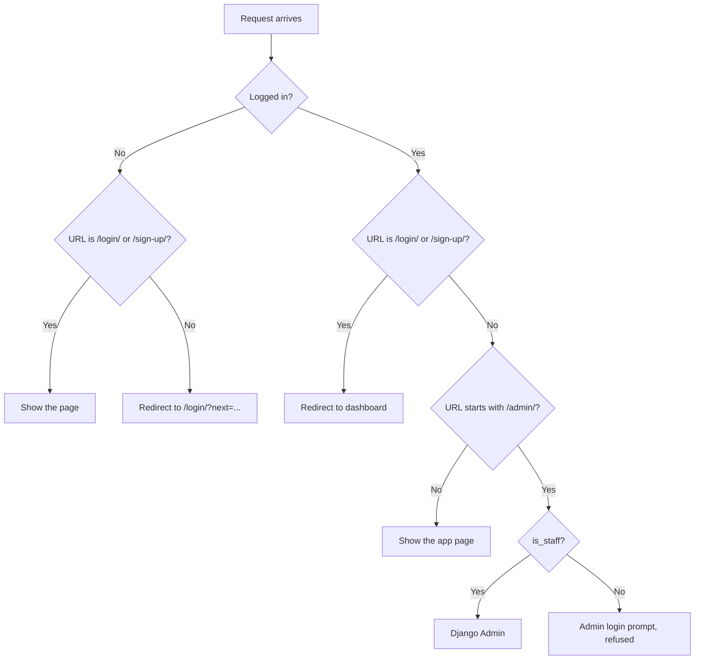
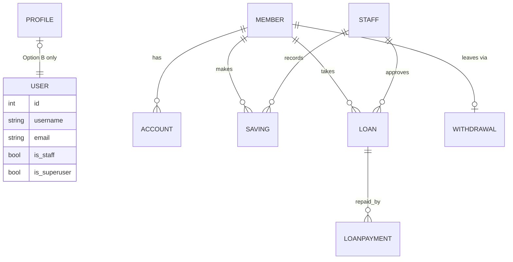
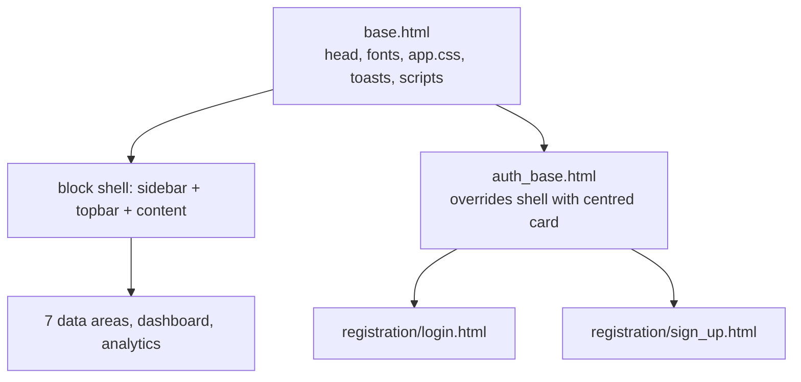
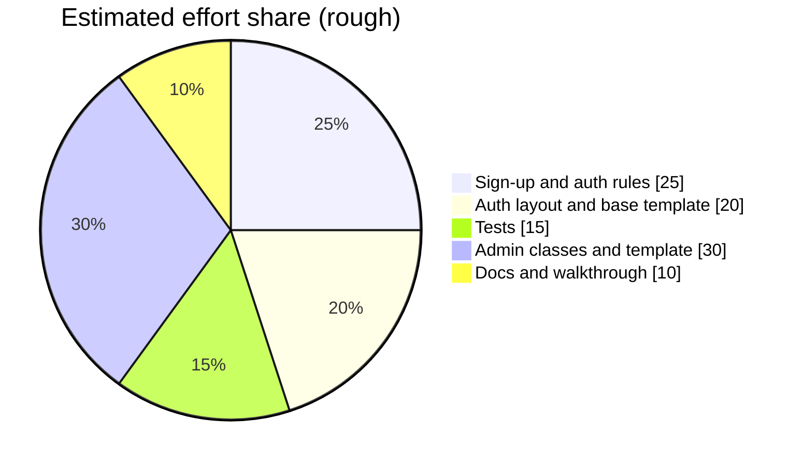
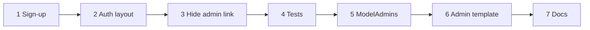

# Sign-up and marking criteria plan

Status: **built** (steps 1 to 7) on branch `feature/signup`. Decisions 1 to 3 in section 10 were built as recommended.
Date: 2026-11-14 (replaces the earlier member-portal draft)

Items marked **(my call)** are decisions I made without asking. Please confirm or overturn them.

## 1. Why this plan exists

The lecturer marks the project on a fixed list, and wants to **see sign-up working**. The
sign-up is for **people who manage the platform**, not for SACCO members. Anyone can register,
log in and work with the SACCO data, but a freshly signed-up person is **neither staff nor
superuser** in Django's sense.

| What the lecturer marks | Pre-marked? |
|---|---|
| HTML, CSS, JavaScript | Yes (front-end mock build), ignore |
| Django Pages | No |
| Models | No |
| CRUD | No |
| Base template | No |
| Django Auth | No |
| Admin template | No |

The one hard requirement about sign-up: **it must exist, be easy to find, and must not appear
for a user who is logged in.**

> **Replaces the earlier draft.** The first version added a member portal (members log in and
> see their own record). That is out. Members stay plain data, exactly as today. Only the people
> operating the back-office get accounts.

## 2. Where we are today

Checked against the code on `main`.

| Criterion | What exists now | Gap |
|---|---|---|
| Django Pages | Dashboard, analytics, 7 data areas (members, staff, accounts, savings, withdrawals, loans, loan payments), login | No sign-up page |
| Models | `Member`, `Staff`, `Account`, `Saving`, `Loan`, `LoanPayment`, `Withdrawal`, with foreign keys | Django's `User` is not related to anything we own (this is fine, see 5.2) |
| CRUD | Add, edit, delete in modals on all 7 areas, plain function views | None |
| Base template | `templates/base.html` holds the shell (sidebar, topbar, toasts) | **`login.html` copies the whole `<head>` instead of extending `base.html`** |
| Django Auth | `LoginView`, `LogoutView`, `@login_required` on **30 view functions** (loans 8, accounts 4, members 4, savings 4, staff 4, withdrawals 4, dashboard 2), one user (`admin`, staff and superuser) | **No sign-up. `/login/` is reachable while logged in** |
| Admin template | `admin.site.register(Member)` style, default Django look | **No customisation at all** |

Summary: Pages, Models and CRUD are solid. **Django Auth, Base template and Admin template are
the weak spots**, and sign-up is the piece the lecturer is looking for.

## 3. Mental model

Think of the app as a building with two doors and a locked room.

Rules in one line each:

1. **Outside pages** (`/login/`, `/sign-up/`) are for logged-out visitors only.
2. **Inside pages** need a login. Everyone who signs up gets in and can see and manage the data.
3. **Django Admin** (`/admin/`) needs `is_staff`, which only a superuser can grant. A signed-up
   user is created with `is_staff = False` and `is_superuser = False`.

## 4. Sign-up: what we will build

### 4.1 Behaviour

| Situation | Today | Planned |
|---|---|---|
| Logged-out visitor opens `/login/` | Login form only | Login form with a **Log in / Sign up** switch at the top of the card and a "New here? Sign up" link below |
| Logged-out visitor opens `/sign-up/` | Does not exist | Username, first name, last name, email, two passwords |
| Submit valid sign-up | n/a | **Creates the user, logs them in, goes to the dashboard** with a welcome toast |
| Submit invalid sign-up | n/a | Same page, errors shown per field |
| Logged-in user opens `/sign-up/` | n/a | **Redirected to the dashboard** |
| Logged-in user opens `/login/` | Login form is shown | **Redirected to the dashboard** |
| Sign-up link inside the app (sidebar, top bar) | n/a | **None, by design** |
| Logged-in user sees "Sign up" anywhere | n/a | **No** |

### 4.2 Visitor states

### 4.3 Request flow for a new sign-up

### 4.4 Access rules per URL

### 4.5 Access matrix

| Page | Anonymous | Signed-up user (not staff) | Admin (staff + superuser) |
|---|---|---|---|
| `/login/` | Yes | Redirected to dashboard | Redirected to dashboard |
| `/sign-up/` | **Yes** | **Redirected to dashboard** | **Redirected to dashboard** |
| `/`, `/analytics/` | Login page | Yes | Yes |
| `/members/`, `/staff/`, `/accounts/`, `/savings/`, `/withdrawals/`, `/loans/`, `/loan-payments/` (+ add, edit, delete) | Login page | Yes | Yes |
| `/admin/` | Admin login | Admin login (refused) | Yes |
| Django Admin link in the sidebar | n/a | **Hidden** | Shown |

### 4.6 Where the lecturer sees it

| Place | Logged out | Logged in |
|---|---|---|
| `/login/` card header switch | Visible | Page not reachable |
| `/login/` footer link | Visible | Page not reachable |
| `/sign-up/` | Visible | Redirected away |
| Sidebar and pages inside the app | n/a | Not present |

## 5. The other marked criteria

### 5.1 Django Auth (strengthened)

| Feature | Status | How it is shown |
|---|---|---|
| Login and logout | Done | Standard Django views |
| Sign-up | New | Section 4 |
| Logged-in-only pages | Done | `@login_required` on 30 views, `LOGIN_URL` in settings |
| Logged-out-only pages | New | Redirect logged-in users away from login and sign-up |
| Password rules | Free | Django validators already configured run inside `UserCreationForm` |
| Staff vs normal user | New | Django Admin link and `/admin/` only for `is_staff` |
| Logged-in name and logout button | Done | Bottom of the sidebar |

Not planned (keeps it simple): password reset by email, email verification, social login, Groups
and per-model permissions.

**Important side effect, in our favour:** the existing tests log in plain users made with
`create_user("clerk")` (not staff). Because every logged-in user keeps access, **only one existing test needed a change**:
`ShellTests.test_shell_has_all_nav_links`, which expected the Django Admin link for a non-staff user. `@login_required` stays as it is. This is a deliberate reason to avoid a
staff-only gate on the data pages.

### 5.2 Models

Two options. **Recommended: Option A.** **(my call)**

| | Option A (recommended) | Option B |
|---|---|---|
| Change | None. Users stay as Django `User` only | Add a `Profile` model, one-to-one with `User` (phone, job title), created at sign-up |
| Effort | Zero | Small to medium: model, migration, form save, admin, template |
| Marking value | Already seven real models with relations | Shows `User` linked to our own model |
| Risk | Lecturer may want to see `User` used | More code to explain and test |

`USER` has no line to the business tables in Option A. That is intentional: people who log in
operate the system, while members and `Staff` rows are records. A signed-up user does **not**
create a `Staff` row (the `Staff.role` Admin/User label stays a plain data label).

### 5.3 CRUD

No change. Already seven areas with add, edit and delete modals. During the demo, a freshly
signed-up user performs one full add, edit and delete to prove sign-up leads to a usable system.

### 5.4 Base template

| Change | Why |
|---|---|
| Add `templates/auth_base.html` that extends `base.html` and holds the centred card, logo and footer link | Login and sign-up stop duplicating markup |
| In `base.html`, wrap the sidebar and topbar in a `` that `auth_base.html` overrides | `login.html` no longer copies the whole `<head>`; inheritance becomes two levels (`base`, then `auth_base`, then page) |
| Keep the existing `title`, `page_title`, `actions`, `content` blocks | Nothing else needs to move |

### 5.5 Admin template

"Admin template" is read here as the **customised Django admin**. If the lecturer meant the
dashboard or something inside our own app, tell me in question 3 of section 10.

| Change | Detail |
|---|---|
| `ModelAdmin` per model | `list_display`, `list_filter` and `search_fields` where it helps, for all 7 models (today `Member` is registered bare) |
| Branding | `site_header`, `site_title`, `index_title` set to "SACCO Management" |
| Template override | `templates/admin/base_site.html` extends Django's, adds the logo and loads `static/css/admin.css` |
| Colours | `admin.css` sets Django's admin colour variables to the app's orange palette, solid colours only |
| Users in admin | Default `User` admin kept, so a superuser can tick *Staff status* to promote someone |
| Why not unfold or jazzmin | Both add packages. The brief says no extras |

## 6. Files that change

| File | Change |
|---|---|
| `core/forms.py` | Add `SignUpForm(UserCreationForm)` with first name, last name, email |
| `core/views.py` (new) | `sign_up`: redirect logged-in users, save, log in, welcome message |
| `core/urls.py` | Add `/sign-up/`; `LoginView.as_view(redirect_authenticated_user=True)` |
| `templates/base.html` | Wrap sidebar and topbar in `` |
| `templates/auth_base.html` (new) | Shared auth card |
| `templates/registration/login.html` | Rewrite to extend `auth_base`, add Log in / Sign up switch |
| `templates/registration/sign_up.html` (new) | Form with the new fields |
| `templates/partials/_sidebar.html` | Wrap the Django Admin link in `` |
| `static/css/app.css` | About 30 lines: the switch and form spacing, own CSS only |
| `*/admin.py` (7 files) | `ModelAdmin` classes |
| `core/admin.py` (new) | Site header and titles |
| `templates/admin/base_site.html` (new) | Admin override |
| `static/css/admin.css` (new) | Admin palette |
| `core/tests.py` | Sign-up and visibility tests |
| `README.md`, `PRODUCT.md` | Update the "one administrator, no logins" lines |

Totals: **about 7 new files, about 14 edited, 0 new packages, 0 migrations.**
`settings.py` needs no change: `LOGIN_REDIRECT_URL = '/'` already points at the dashboard.

## 7. Build order and effort

Effort figures are rough estimates, not measurements.

| Step | Work | Size | Commit message idea |
|---|---|---|---|
| 1 | `SignUpForm`, `sign_up` view, route, login redirect rule | S | Add sign-up that signs the new user in |
| 2 | `auth_base.html`, `shell` block, login rewrite, Log in / Sign up switch | M | Share one auth layout between login and sign-up |
| 3 | Hide Django Admin link for non-staff | S | Show the admin link to staff only |
| 4 | Tests for the access rules | S | Test sign-up and logged-in redirects |
| 5 | `ModelAdmin` classes and site titles | S | Customise the admin for every model |
| 6 | Admin template override and palette | M | Brand the Django admin |
| 7 | README, PRODUCT, manual walkthrough | S | Document sign-up and admin |

Roughly 6 to 7 hours in total.

## 8. Test plan

Automated (Django `TestCase`), all in `core/tests.py`:

| Test | Expected |
|---|---|
| Logged-out GET `/sign-up/` | 200, form shown |
| Valid POST to `/sign-up/` | User exists, `is_staff` and `is_superuser` both false, response redirects to dashboard, user is logged in |
| Password mismatch POST | 200, no user created |
| Duplicate username POST | 200, error shown |
| Logged-in GET `/sign-up/` | 302 to dashboard |
| Logged-in GET `/login/` | 302 to dashboard |
| Logged-out GET `/members/` | 302 to `/login/?next=/members/` |
| Signed-up user GET `/members/` | 200 (they can manage data) |
| Signed-up user GET `/admin/` | Redirected to admin login |
| Signed-up user dashboard HTML | Does not contain "Sign up" or "Django Admin" |
| Staff dashboard HTML | Contains the Django Admin link |
| Existing 30 views, existing tests | All still pass (one nav-link test updated for the staff-only admin link) |

Manual, in the browser: sign up, land on the dashboard, add a member, edit it, delete it, log
out, check the sign-up page is visible again.

## 9. Marking demo script

A route the lecturer can follow in five minutes.

| Step | What to show | Criterion it proves |
|---|---|---|
| 1 | Open `/` logged out, get sent to login, point at the Sign up switch | Django Auth |
| 2 | Create an account on `/sign-up/` | Django Auth, Django Pages |
| 3 | Land on the dashboard, open `/sign-up/` by hand, get bounced back, note no Sign up anywhere and no Django Admin link | Django Auth |
| 4 | Add, edit, delete a member in the modal | CRUD, Models |
| 5 | Open `login.html` and `sign_up.html`, show `extends "auth_base.html"`, then `auth_base.html` extending `base.html` | Base template |
| 6 | Log in as `admin`, open Django Admin, show custom list columns, search and branding; open Users and show the new account has *Staff status* unticked | Admin template, Django Auth |
| 7 | Show `core/tests.py` passing | Quality of Auth work |

## 10. Decisions we need from you

| # | Question | Recommendation |
|---|---|---|
| 1 | After sign-up, sign the user in straight away (like GitHub), or send them to login? | Sign in straight away |
| 2 | Should everyone who signs up get full add, edit and delete rights, or read-only until an admin approves them? | Full rights. It is a class demo, and it keeps the existing tests valid. Approval is a possible extra if the lecturer asks |
| 3 | By "admin template", does the lecturer mean the customised Django admin, or the dashboard inside our app? | Customised Django admin, as planned in 5.5 |

Optional extras we are **not** building unless you ask: the `Profile` model (5.2 Option B),
read-only mode for new accounts, approval of new accounts, password reset by email.

## 11. Risks

| # | Risk | Effect | Mitigation |
|---|---|---|---|
| 1 | Open sign-up gives full access to all demo data | Anyone who finds the URL can edit data | Acceptable for a class demo. Question 2 covers tightening |
| 2 | Someone expects a signed-up user to see Django Admin | Confusion at the demo | Say so in the walkthrough; only a superuser can grant *Staff status* |
| 3 | `db.sqlite3` gets test accounts committed | Stray users in the shared demo data | Delete demo sign-ups in Django Admin before committing |
| 4 | Splitting `base.html` into a `shell` block breaks the layout | Pages lose sidebar | `ShellTests` already check nav links and assets; run them after step 2 |
| 5 | Admin override breaks after a Django upgrade | Admin looks default | Only colour variables and one block are overridden, so the surface is small |

## 12. Decisions I made (please check)

1. Sign-up creates a Django `User` only, with `is_staff = False` and `is_superuser = False`.
2. Every logged-in user can use all 7 data areas; `@login_required` stays, no new decorator.
3. Models: Option A, no `Profile`, no migration.
4. `login.html` and the new `sign_up.html` extend a small `auth_base.html`, which extends `base.html`.
5. The Django Admin sidebar link shows for `is_staff` only.
6. No password reset, email verification or change-password page in this round.
