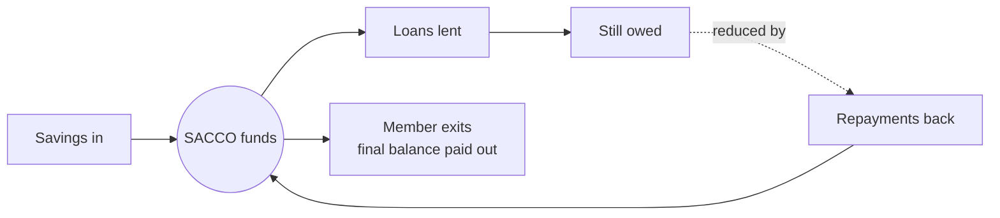
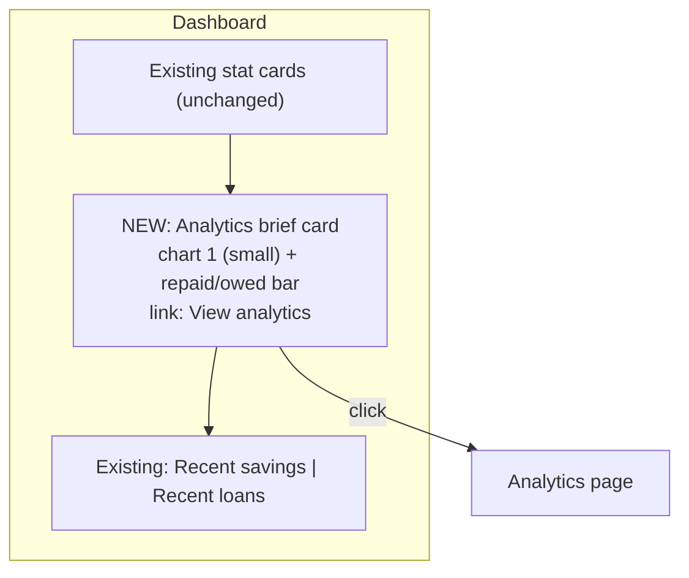
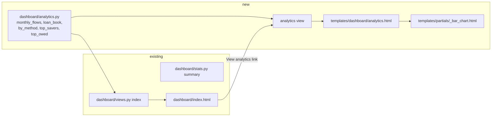
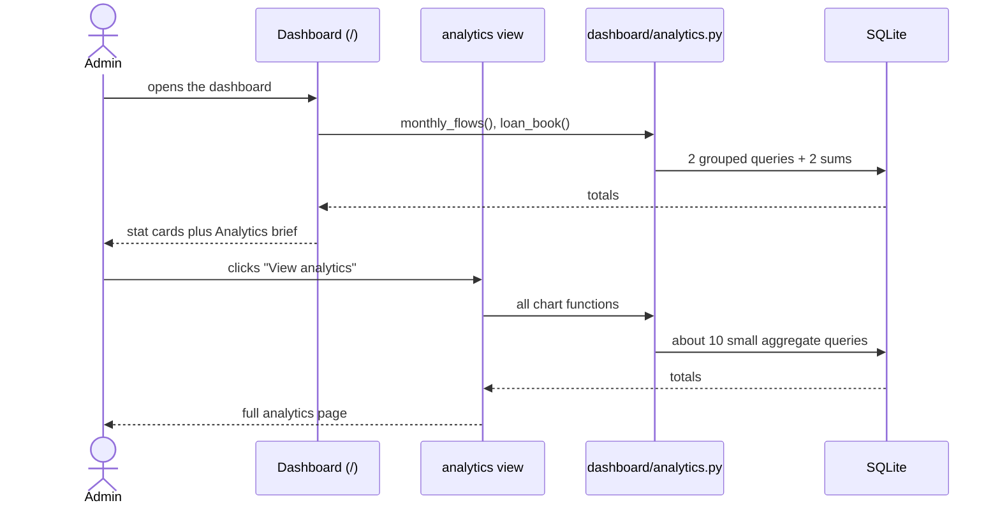
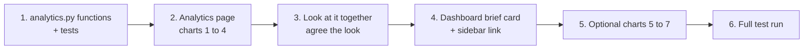

# Analytics Proposal: a dedicated page plus a brief on the dashboard

> Status: **proposal only, nothing built.** Read it, tell me what to cut or change, then we build.
> Branch: `feature/analytics`
> Written for: you, the owner of the SACCO app, deciding what to build.

## 1. The idea in one paragraph

Add one **Analytics** page that answers a handful of plain questions about the SACCO's money, using data you already store. Put a small **brief** (one chart and one progress bar) on the main dashboard with a "View analytics" link to the full page. No new models, no migrations, no chart library, no new packages. Charts are drawn server-side as plain HTML/CSS bars, in keeping with your own-CSS-only rule.

## 2. Mental models (how to think about the numbers)

These four ideas decide what is worth charting and what is noise.

| Mental model | Meaning | Where it shows up here |
|---|---|---|
| **Money in, money lent, money owed, members leaving** | Savings come in, loans are lent out, repayments come back. A **withdrawal is not a routine payout: it is a member exiting the SACCO**, and the amount is their final balance paid out. | Charts 1 to 4 |
| **Stock vs flow** | A *stock* is a total at a moment (total savings, still owed). A *flow* is an amount over a period (savings this month). Stocks go in number cards, flows go in trend charts. | Dashboard keeps stocks. Analytics adds flows. |
| **One question per chart** | If a chart cannot be captioned as a question ("Are members saving steadily?"), cut it. | Section 4 gives each chart its question. |
| **Only chart what is stored** | Analytics can only rearrange the data. If a date or field does not exist, the chart does not exist. | See the gaps in section 3. |



## 3. What the data can and cannot support

| Model | Date field? | Amount? | Other groupable fields | Good for trends? |
|---|---|---|---|---|
| Saving | `date` | `amount` | `payment_method`, `member`, `staff`, `account` | Yes |
| Withdrawal (a member exit) | `date` | `amount` (final balance paid out) | `member` | Yes |
| LoanPayment | `date` | `amount` | `loan`, therefore member | Yes |
| Loan | **none** | `loan_amount` | `member`, `staff`, `payment_period` | **No**, only totals and rankings |
| Account | **none** | `opening_balance` | `account_type` | **No**, only totals |
| Member | **none** | n/a | `gender` | **No**, no join date, so no growth chart |
| Staff | **none** | n/a | `role`, `position` | Only via savings they recorded |

Consequences:

- "Loans issued per month" and "member growth" are **not possible** without adding a date field to those models. They are out of scope.
- The existing dashboard total (opening balances plus savings) does **not** subtract withdrawals. Withdrawals are exits, not a monthly outflow to net against savings, so the analytics page shows them as their own chart and never mixes them with savings.

## 4. The analytics, ranked

Build charts 1, 1b, 2, 3 and 4; the rest are optional extras.

| # | Question it answers | Chart | Data | Where | Priority |
|---|---|---|---|---|---|
| 1 | Are members saving steadily? | **Bars**, last 12 months | `Saving` summed per month | Dashboard brief + page | **Must** |
| 1b | Are members leaving, and how much is paid out? | **Bars**, last 12 months (each withdrawal is one member exiting) | `Withdrawal` summed per month | Page | **Must** |
| 2 | How much of the loan book is repaid? | **One progress bar** with "62% repaid", plus repaid and owed amounts | `Loan`, `LoanPayment` totals | Dashboard brief + page | **Must** |
| 3 | Are repayments steady month to month? | **Bars or line**, last 12 months | `LoanPayment` summed per month | Page | **Must** |
| 4 | How do members pay in? | **Stacked bar** (or donut) by Cash / Mobile / Bank | `Saving` summed per `payment_method` | Page | **Must** |
| 5 | Who are our biggest savers, and who owes the most? | Two **horizontal bar** lists, top 5 each | Saving sum per member; loan amount minus payments per member | Page | Should |
| 6 | How are accounts split? | Two plain numbers (Savings, Current), **no chart** | `Account` counts by `account_type` | Page | Could |
| 7 | How busy is each staff member? | **Horizontal bars**, savings recorded per staff | `Saving` count per `staff` | Page | Could |

**Chart recommendations and why**

| Choice | Reason |
|---|---|
| Bars, not lines, for monthly money | Months are separate buckets; bars read as "this month's total" with no implied smoothness. |
| A progress bar for repaid vs owed | It is a single part-of-whole; a pie is heavier for the same message. |
| Stacked bar over donut for payment methods | Three categories compare more accurately as lengths than angles. |
| Horizontal bars for rankings | Member and staff names are long and read better on the left. |
| No chart for account types | Two numbers are clearer than any picture. |
| Palette colours only | Reuse the existing variables (`--flame`, `--fantastic`, `--truffle`, `--oatmeal`). Savings and repayments in `--flame`; exits in `--fantastic`. `--truffle` stays reserved for delete and errors. |
| Always show the value labels | Plain HTML bars can carry the number in text, which also helps accessibility. |

## 5. Page layouts

### Dashboard (existing page, one new card)



### Analytics page (new, at `/analytics/`)

```text
+---------------------------------------------------------------+
| Analytics                                                     |
+----------------------------+----------------------------------+
| 1. Savings per month       | 1b. Member exits per month       |
|    (12 months)             |    (final balances paid out)     |
+----------------------------+----------------------------------+
| 3. Repayments per month    | 2. Loan book: repaid vs owed     |
|    (12 months)             |    [=========>      ] 62%        |
+----------------------------+----------------------------------+
| 4. Savings by payment method                                  |
|    [Cash|Mobile|Bank] stacked                                 |
+----------------------------+----------------------------------+
| 5a. Top 5 savers           | 5b. Top 5 owed                   |
+----------------------------+----------------------------------+
```

A sidebar link "Analytics" (with a chart icon) sits under Dashboard.

## 6. How it fits the existing code



My call: keep this inside the existing **`dashboard`** app instead of making a new app. It is the same audience, same login rule and same style of code as `stats.py`, so a new app would be extra ceremony.

| Piece | File | What it does |
|---|---|---|
| Queries | `dashboard/analytics.py` (new) | One function per chart. Each returns plain lists and dicts. |
| View | `dashboard/views.py` | `analytics(request)` with `@login_required`, like `index`. |
| URL | `core/urls.py` | `path('analytics/', dashboard_views.analytics, name='analytics')`. |
| Template | `templates/dashboard/analytics.html` | Cards and charts. |
| Chart partial | `templates/partials/_bar_chart.html` (new) | Draws one bar row from a label, a value and a percentage width. |
| Dashboard brief | `templates/dashboard/index.html` | One card with the link. |
| Sidebar | `templates/partials/_sidebar.html` | One nav item. |
| CSS | `static/css/app.css` | `.bars`, `.bar`, `.progress` rules, about 60 lines. |

No model changes, no migrations, no new packages, `db.sqlite3` is untouched.

## 7. Code outline

### 7.1 Monthly totals, with empty months filled in

```python
# dashboard/analytics.py
from datetime import date
from django.db.models import Sum
from django.db.models.functions import TruncMonth

def month_starts(count=12, today=None):
    """First day of each of the last `count` months, oldest first."""
    today = today or date.today()
    y, m = today.year, today.month
    months = []
    for _ in range(count):
        months.append(date(y, m, 1))
        m -= 1
        if m == 0:
            y, m = y - 1, 12
    return months[::-1]

def monthly_totals(model, months):
    rows = (model.objects.filter(date__gte=months[0])
            .annotate(month=TruncMonth("date"))
            .values("month").annotate(total=Sum("amount")))
    by_month = {r["month"]: r["total"] for r in rows}
    return [by_month.get(m, 0) for m in months]   # a month with no rows shows 0

def monthly_flows():
    months = month_starts()
    return {
        "months": months,
        "savings": monthly_totals(Saving, months),
        "exits": monthly_totals(Withdrawal, months),   # a withdrawal is a member leaving
        "repayments": monthly_totals(LoanPayment, months),
    }
```

### 7.2 Loan book

```python
def loan_book():
    lent = Loan.objects.aggregate(t=Sum("loan_amount"))["t"] or 0
    repaid = LoanPayment.objects.aggregate(t=Sum("amount"))["t"] or 0
    return {"lent": lent, "repaid": repaid, "owed": lent - repaid,
            "percent": round(100 * repaid / lent) if lent else 0}   # avoid dividing by zero
```

### 7.3 Savings by payment method and top 5 savers

```python
def savings_by_method():
    return (Saving.objects.values("payment_method")
            .annotate(total=Sum("amount")).order_by("-total"))

def top_savers(limit=5):
    return (Saving.objects.values("member__id", "member__first_name", "member__last_name")
            .annotate(total=Sum("amount")).order_by("-total")[:limit])
```

### 7.4 A chart bar is just HTML and CSS

```html
{# partials/_bar_chart.html: one row #}
<div class="bar-row">
  <span class="bar-label">{{ label }}</span>
  <span class="bar-track"><span class="bar-fill" style="width: {{ percent }}%"></span></span>
  <span class="bar-value">{{ value|ugx }}</span>
</div>
```

```css
.bar-track { flex: 1; height: 10px; border-radius: 99px; background: var(--oatmeal); }
.bar-fill  { display: block; height: 100%; border-radius: 99px; background: var(--flame); }
```

For the grouped monthly chart each month is a small column pair whose heights are `value / max * 100`, worked out in the view so the template does no arithmetic.

## 8. Request flow



## 9. Scope

| In | Out (on purpose) |
|---|---|
| 5 must-have charts, 3 optional | Chart libraries (Chart.js etc.), JavaScript charts |
| Last-12-months window, fixed | Date-range pickers, filters |
| Server-side HTML/CSS bars | Interest, forecasts, default prediction |
| Dashboard brief with link | Export to CSV or PDF |
| Tests for the query functions | Caching, background jobs, new models, API endpoints |

## 10. Testing

| Test | Proves |
|---|---|
| `month_starts` returns 12 months, oldest first, across a year boundary | The month list is right in January |
| `monthly_totals` fills months with no rows with 0 | No gaps in the chart |
| `loan_book` with no loans returns 0 percent, not an error | No divide-by-zero on an empty database |
| `loan_book` repaid + owed equals lent | The figures agree with the dashboard |
| `savings_by_method` groups Cash, Mobile and Bank correctly | The method split adds up to total savings |
| `top_savers` is ordered and limited to 5 | The ranking is correct |
| Analytics page redirects to login when logged out | `@login_required` is in place |
| Analytics page renders with an empty database | Empty state works |
| Dashboard contains the link to `/analytics/` | The brief is wired up |

## 11. Build order (after you approve)



## 12. Decisions for you

| # | Question | My recommendation |
|---|---|---|
| 1 | Is the main question "are members saving, are they leaving, and who owes us"? (my guess from your brief, updated now that withdrawals are known to be exits) | Yes. Charts 1, 1b and 2 serve it. |
| 2 | Build only the 4 must-haves first? | Yes. Add 5 to 7 only if you want them. |
| 3 | Fixed last-12-months window, no date picker? | Yes, to keep it simple. |
| 4 | Keep it inside the `dashboard` app? | Yes (section 6). |
| 5 | Should rankings (5) show member names as plain text, or link to their row on the Members page? | Plain text. A link would need a search or detail page. With search now in place you could link to `/members/?q=MEM-007` later. |
