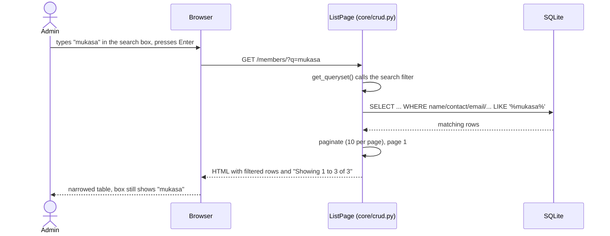
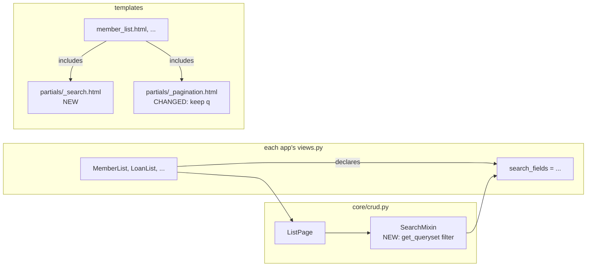
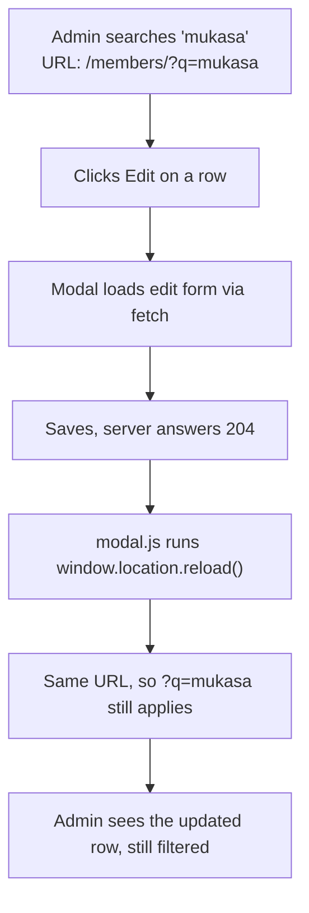
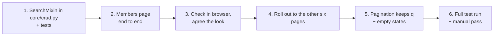

# Search Boxes on Every List Page: Plan

> Status: **proposal, nothing built yet.** Read this, tell me what to change, then we build.
> Branch: `feature/search-boxes`

## 1. The short version

Add one search box above the table on each of the seven list pages (Members, Staff, Accounts, Savings, Loans, Loan payments, Withdrawals). Type, press Enter (or the search button), and the table narrows to matching records. Clear it and everything comes back.

**CRUD impact: this is a Read-only feature.** Only the **R** (the list view) changes. Create, Update and Delete are untouched. The modal forms, their views and their URLs stay as they are. The one place they interact with search is a bonus: after you save or delete in a modal, the page reloads and **keeps your search** (see section 6).

| CRUD letter | Touched? | Why |
|---|---|---|
| **C**reate | No | The Add modal and `*Create` views are unchanged. |
| **R**ead | **Yes, all of it** | `ListPage` in `core/crud.py` gets a filter. Each list template gets a search box. Pagination links learn to keep the search. |
| **U**pdate | No | Edit modal unchanged. A reload after saving keeps the search in the URL. |
| **D**elete | No | Same. The delete modal unchanged. |

The dashboard page has no table of records, so it gets no search box.

## 2. How it works (flow)

The search is **server-side and GET-based**. The query lives in the URL as `?q=...`. There is no JavaScript for the basic version, so it works with the page reload you already have, and a filtered page can be bookmarked or refreshed.



Where the change sits in the code that already exists:



## 3. The one tricky bit: the codes (MEM-007, LN-012, ...)

The ID column shows codes like `MEM-007`. These are **not stored in the database**. `CodedModel.code` builds them on the fly from the row's `id` and a prefix (`core/models.py`). So a database `LIKE '%MEM-007%'` would find nothing.

Plan: the search understands codes in Python before it touches the database.

| What the admin types | What we do | Result |
|---|---|---|
| `MEM-007` or `mem-7` or `mem007` | Prefix matches this page's `code_prefix`, number becomes `id = 7` | Member 7 |
| `7` | Also try `id = 7` alongside the text search | Member 7, plus anyone with a 7 in their phone number |
| `LN-012` on the Loan payments page | Prefix is `LN`, so this is a loan code, filter `loan_id = 12` | All payments on loan 12 |
| `MEM-007` on the Savings page | Prefix is `MEM`, which is the member FK, filter `member_id = 7` | All savings for member 7 |

Each page therefore declares which prefixes map to which column, not just a list of text fields.

## 4. What each page searches

Matching is case-insensitive "contains". Multi-word input is split on spaces: **every word must match somewhere**, in any of the listed fields. So `john mukasa` finds John Mukasa even though first and last name are separate columns.

| Page | Text fields searched | Code prefixes understood | Search hint (placeholder) |
|---|---|---|---|
| Members | `first_name`, `last_name`, `contact`, `address`, `email` | `MEM` = own id | Search name, contact, email, address or MEM-001 |
| Staff | `first_name`, `last_name`, `position`, `contact`, `address`, `role` | `STF` = own id | Search name, position, contact or STF-001 |
| Accounts | `account_number`, `account_type`, `member__first_name`, `member__last_name` | `ACC` = own id, `MEM` = `member_id` | Search account number, member or ACC-001 |
| Savings | `member__first_name`, `member__last_name`, `account__account_number`, `staff__first_name`, `staff__last_name`, `payment_method` | `SAV` = own id, `MEM` = `member_id`, `ACC` = `account_id`, `STF` = `staff_id` | Search member, account, staff or SAV-001 |
| Loans | `member__first_name`, `member__last_name`, `staff__first_name`, `staff__last_name`, `payment_period` | `LN` = own id, `MEM` = `member_id`, `STF` = `staff_id` | Search member, staff or LN-001 |
| Loan payments | `loan__member__first_name`, `loan__member__last_name` | `PAY` = own id, `LN` = `loan_id` | Search member, loan or PAY-001 |
| Withdrawals | `member__first_name`, `member__last_name` | `WDR` = own id, `MEM` = `member_id` | Search member or WDR-001 |

**Deliberately not searched in version 1** (open to your call, see section 8):

- **Money amounts** (loan amount, balance, ...). Typing `850000` against numbers shown as `UGX 850,000` is confusing, and a range filter is a different feature.
- **Dates.** Shown as `9 Nov 2026`, stored as `2026-11-09`; matching what people type to either is fiddly.
- **Gender** (`M`/`F` are stored letters, so `male` would not match without extra mapping).

## 5. The code, in outline

These snippets show the shape. Names may shift slightly when built.

### 5.1 `core/crud.py`: a `SearchMixin` that `ListPage` uses

```python
import re
from functools import reduce
from operator import or_
from django.db.models import Q

CODE_RE = re.compile(r"^([a-z]+)-?(\d+)$", re.IGNORECASE)


class ListPage(LoginRequiredMixin, ListView):
    ...
    search_fields = []          # text columns, e.g. ["first_name", "contact"]
    search_codes = {}           # prefix -> column, e.g. {"MEM": "pk", "STF": "staff_id"}
    search_hint = ""

    def get_search_term(self):
        return self.request.GET.get("q", "").strip()

    def search(self, queryset, term):
        for word in term.split():
            clauses = [Q(**{f"{f}__icontains": word}) for f in self.search_fields]

            match = CODE_RE.match(word)
            if match and match[1].upper() in self.search_codes:
                clauses.append(Q(**{self.search_codes[match[1].upper()]: int(match[2])}))
            elif word.isdigit():
                clauses.append(Q(pk=int(word)))

            queryset = queryset.filter(reduce(or_, clauses))   # AND across words
        return queryset

    def get_queryset(self):
        queryset = super().get_queryset()
        term = self.get_search_term()
        return self.search(queryset, term) if term else queryset

    def get_context_data(self, **kwargs):
        context = super().get_context_data(**kwargs)
        context["q"] = self.get_search_term()
        context["search_hint"] = self.search_hint
        return context
```

### 5.2 Each app's view just declares what to search

```python
# members/views.py
class MemberList(ListPage):
    model = Member
    page_title = "Members"
    add_label = "Add member"
    url_name = "member"
    search_fields = ["first_name", "last_name", "contact", "address", "email"]
    search_codes = {"MEM": "pk"}
    search_hint = "Search name, contact, email, address or MEM-001"
```

```python
# loans/views.py  (LoanList)
    search_fields = [
        "member__first_name", "member__last_name",
        "staff__first_name", "staff__last_name", "payment_period",
    ]
    search_codes = {"LN": "pk", "MEM": "member_id", "STF": "staff_id"}
```

The existing `select_related(...)` calls in `get_queryset` already join `member` / `staff`, so searching across those foreign keys adds no extra queries per row.

### 5.3 New `templates/partials/_search.html`

```html
<form class="search" method="get" role="search">
  <label class="visually-hidden" for="search-q">Search</label>
  <i data-lucide="search" aria-hidden="true"></i>
  <input id="search-q" type="search" name="q" value="{{ q }}"
         placeholder="{{ search_hint }}" autocomplete="off">
  <button type="submit" class="btn btn-primary">Search</button>
  <a class="btn" href="{{ request.path }}">Clear</a>
</form>
```

Each of the seven list templates adds one line inside the card, above `.table-wrap`:

```html
<section class="card">
  
  <div class="table-wrap"> ... </div>
```

### 5.4 `templates/partials/_pagination.html`: keep the search when changing page

Today the page links are `?page=2`, which would **drop the search**. Django 6.1 has a built-in `` tag that rewrites one parameter and keeps the rest:

```html
<a class="page-link" href="" ...>{{ number }}</a>
```

### 5.5 Empty state when nothing matches

The templates currently say "No members yet." That is wrong when a search found nothing:

```html
<tr><td class="table-empty" colspan="8">
  No members match "{{ q }}".No members yet.
</td></tr>
```

(Same one-line change on all seven templates, with each page's own noun.)

### 5.6 CSS

A `.search` rule block in `static/css/app.css` using the existing colour variables and the same input styling as the modal fields. No new libraries, matching the "own CSS only" rule for this project. On narrow screens the box goes full width above the table.

## 6. How it plays with Create / Update / Delete



`modal.js` reloads the current URL after any successful save or delete, and the query string is part of that URL. **So the search survives with zero changes to the Create/Update/Delete code.** Two edge cases, both acceptable:

| Situation | What happens | OK? |
|---|---|---|
| Admin adds a member who doesn't match the active search | Row isn't shown after reload. The toast says "MEM-021 saved". | Yes, standard behaviour. The "Clear" link is right there. |
| Admin deletes the last row of a filtered page 2 | `ListPage` already clamps an out-of-range `?page=` to the last page. | Yes, no change needed. |

## 7. Files that would change

| File | Change | Size |
|---|---|---|
| `core/crud.py` | Add search attributes and `get_queryset` / `search` / context to `ListPage` | ~35 lines |
| `members/views.py`, `staff/views.py`, `accounts/views.py`, `savings/views.py`, `loans/views.py` (two views), `withdrawals/views.py` | Declare `search_fields`, `search_codes`, `search_hint` | ~4 lines each |
| `templates/partials/_search.html` | **New** | ~8 lines |
| `templates/partials/_pagination.html` | Use `` | 1 line |
| 7 list templates under `templates/*/` | Include search partial; empty-state wording | 2 lines each |
| `static/css/app.css` | `.search` styles | ~40 lines |
| `core/tests.py` (and per-app `tests.py`) | New tests (below) | ~100 lines |

No model changes, **no migrations**, no new packages, `db.sqlite3` is untouched.

## 8. Decisions (answered 2026-11-09)

| # | Question | Decision |
|---|---|---|
| 1 | Search on Enter / button press, or as you type? | **On Enter** (page reload, no JavaScript). Live search can be a later step. |
| 2 | Search dates and money amounts? | **Left out.** |
| 3 | Match codes like `MEM-007`? | **Yes** (section 3). |
| 4 | Clear link when a search is active? | **Yes.** |
| 5 | Extra filters? | **Out of scope.** Search only. |

## 9. How we will test it

```python
# example, core/tests.py style
def test_member_search_matches_across_first_and_last_name(self):
    Member.objects.create(first_name="John", last_name="Mukasa", ...)
    Member.objects.create(first_name="Jane", last_name="Doe", ...)
    response = self.client.get(reverse("member_list"), {"q": "john mukasa"})
    self.assertContains(response, "Mukasa")
    self.assertNotContains(response, "Doe")

def test_code_search_finds_by_id(self):
    member = Member.objects.create(...)
    response = self.client.get(reverse("member_list"), {"q": member.code})
    self.assertEqual(list(response.context["object_list"]), [member])
```

| Test | Proves |
|---|---|
| No `q` returns everything | Existing behaviour is unchanged |
| Case-insensitive, partial match | `muk` finds Mukasa |
| Two words across two columns | `john mukasa` works |
| `MEM-007` / `mem7` / `7` | Code parsing |
| Foreign-key search (loan by member name) | Joins work |
| Wrong prefix (`XYZ-5`) | Falls back to text search, no crash |
| `q` with `%`, `_`, quotes | No SQL injection, no error (the ORM escapes them) |
| Page 2 link contains `q=` | Pagination keeps the search |
| Logged-out request | Still redirects to login (`LoginRequiredMixin` is inherited) |
| Empty result | Shows the "No ... match" message |

Then a manual pass in the browser on all seven pages, at desktop and phone width.

## 10. Build order (once you approve)



Doing Members first means you see the real thing on one page before it is copied six times.

## 11. Risks and non-goals

- **Performance:** `icontains` is a table scan, fine for a class-project SACCO (hundreds to low thousands of rows). Not designed for millions.
- **Non-goals:** full-text search, fuzzy matching or typo tolerance, sorting by column, saved searches, exporting results.
- **Safe by construction:** all filtering goes through the Django ORM, which parameterises values. Nothing is concatenated into SQL.
