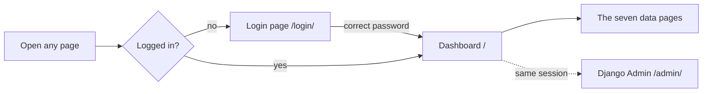
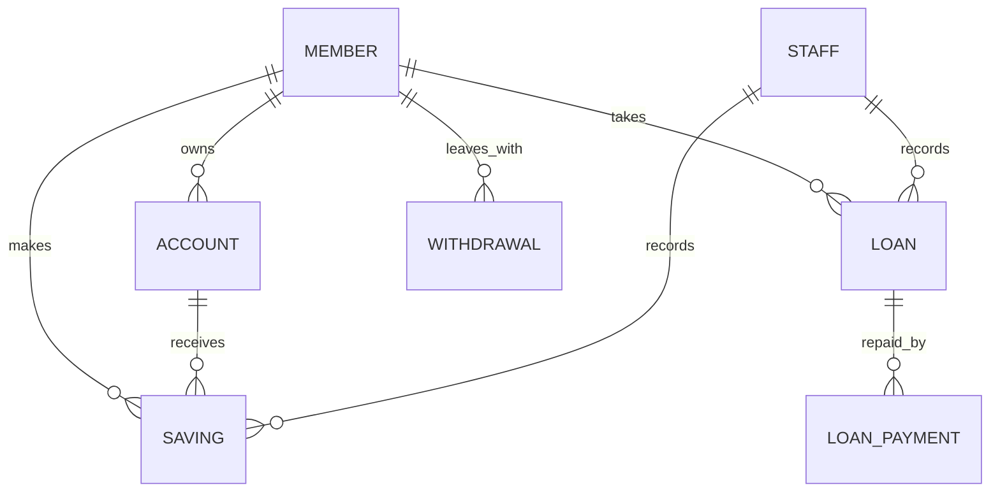
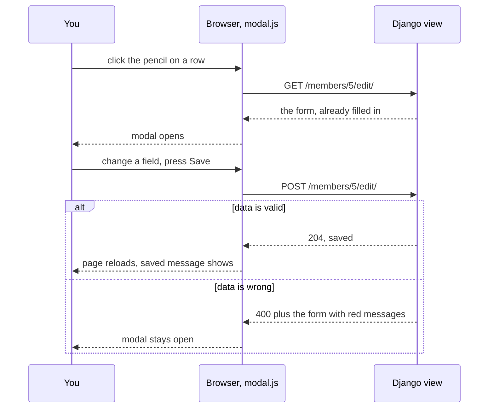

# SACCO dashboard: design and build plan

Date: 2026-11-08
Status: decisions agreed, waiting for the go-ahead to build
Visual version (mockups, private link): https://claude.ai/artifact/B7LiVqyn4snDtaBa9MybEr

This is a university class project. It must work for the demo and must not be over-engineered.

## 1. What we are building

A Django back-office app for one administrator. They log in, see a dashboard of live numbers, and manage seven kinds of records (members, staff, accounts, savings, withdrawals, loans, loan payments) with Add, Edit and Delete.

- Login and logout that work (Django's built-in sign-in). Every page except the login page needs it.
- A left sidebar with Dashboard on top, one flat list of the seven data areas (each with its own icon), and a Django Admin link at the bottom.
- A home dashboard: eight live number cards and two "recent activity" tables, all from the database.
- One table page per data area. A large **Add** button at the top opens a modal. Each row has a pencil icon (edit, in a modal) and a trash icon (delete, with a confirmation modal).
- Our own CSS only. No Bootstrap, no Tailwind, no jQuery. We copy only the look of the Material Dashboard template.
- Model fields come from the frontend pages, not from `SACCO Script.sql`.
- `db.sqlite3` is committed to GitHub. `*.sqlite3` was removed from `.gitignore` (change made 2026-11-08, not yet committed).

## 2. Decisions

| Topic | Decision |
|---|---|
| Palette | Image 1: Palladian `#EEE9DF`, Oatmeal `#C9C1B1`, Blue Fantastic `#2C3B4D`, Burning Flame `#FFB162`, Truffle Trouble `#A35139`, Abyssal Anchorfish Blue `#1B2632` |
| IDs | Numbered automatically by Django, shown as codes: `MEM-001`, `STF-001`, `ACC-001`, `SAV-001`, `LN-001`, `PAY-001`, `WDR-001`. Worked out from the number, not stored twice. Deleted numbers are not reused |
| Withdrawal | Only a record. It does not close the member's accounts. The amount is the member's final balance, typed in |
| Staff role | A label only (dropdown: Admin or User). No permissions, no login link |
| Sidebar | One flat list (option D). Options A, B and C were considered and not chosen (see section 9) |
| CSS | One file, `static/css/app.css`, with the palette as CSS variables at the top. The nine per-page CSS files are removed |
| Icons | Lucide, one JS file saved into `static/js/` so the demo works offline |
| Repo | Owner only. The owner commits `db.sqlite3` after the fill script has run |

## 3. Who uses it, and Django Admin

One administrator is the only user. Members, staff records and accounts are plain data, never logins.



| | Our dashboard | Django Admin |
|---|---|---|
| What | The app we build, used in the demo | Free tool at `/admin/` |
| Look | Our sidebar, palette, modals | Django's standard screens |
| Login | `/login/` | Own login page, same user and password |
| Our work | Pages, forms, modals, dashboard | One line per model to register it |
| Good for | Daily data entry | Checking raw data, changing the administrator's password, adding another administrator |

- Logging in on our page also logs you in to `/admin/` (same session).
- The administrator is created once with `python manage.py createsuperuser`.
- We build no user management (no register page, no password reset screens).
- Account here means a bank account record. It is not Django's `AbstractUser` and has nothing to do with sign-in. The app folder is named `accounts` only as a folder name.

## 4. Pages and addresses

The current flat addresses (`/member.html` and so on) are replaced. Each app gets a small `urls.py` included from `core/urls.py`.

| Page | Address | Modal actions |
|---|---|---|
| Login | `/login/` | none (Logout is a button in the sidebar) |
| Dashboard | `/` | none, view only |
| Members | `/members/` | `add/`, `<id>/edit/`, `<id>/delete/` |
| Staff | `/staff/` | same three |
| Accounts | `/accounts/` | same three |
| Savings | `/savings/` | same three |
| Withdrawals | `/withdrawals/` | same three |
| Loans | `/loans/` | same three |
| Loan payments | `/loan-payments/` | same three |

Django Admin stays at `/admin/`.

## 5. Data models

Fields follow the frontend forms and tables. Where the SQL script differs, the frontend wins.



| Model | Fields | Notes |
|---|---|---|
| Member | id (automatic), first_name, last_name, contact, address, email, gender (Male or Female) | |
| Staff | id (automatic), first_name, last_name, gender, position, role (Admin or User), contact, address | The frontend form has four fields but the table shows eight. We use all eight. Role is a label only |
| Account | id (automatic), member, account_number, account_type (Savings or Current), opening_balance | A bank account record, not a login. Account number is a typed detail, not the ID |
| Saving | id (automatic), member, account, staff, payment_method (Cash, Mobile Money, Bank Transfer), amount, date | |
| Loan | id (automatic), member, staff, loan_amount, payment_period, payment_amount | Payment period is free text such as "12 months" |
| LoanPayment | id (automatic), loan, amount, date | |
| Withdrawal | id (automatic), member, amount, date | Frontend column is "Amount (Final Balance)" |

Rules:

- Account balance is worked out, not stored: opening balance + all savings into that account.
- Still owed on a loan = loan amount - all its payments. No interest.
- Deleting a member deletes their accounts, savings, loans and withdrawals. The delete modal warns about it.
- Money is whole shillings (UGX), shown like `UGX 850,000`. This needs Django's `humanize` app switched on.
- The "staff" on a saving or loan means which employee handled it. It is picked from a dropdown and is separate from who is logged in.

Where the frontend and the SQL script disagree, the frontend was followed:

- The pages show prefixed codes (`MEM-001`); the SQL uses plain numbers. We number automatically and show the prefixed code.
- SQL staff has no address; the staff table shows one.
- SQL account has "Balance"; the form asks for "Opening balance".
- SQL savings has no account link; the saving form has "Account id".

## 6. How Add, Edit and Delete work

Every data page uses the same pattern, built once for Members and copied.



- Django's ready-made list, create, update and delete views do the database work (about four short classes per app).
- One shared modal template draws any form by looping over its fields.
- `static/js/modal.js` (about 40 lines) opens the browser's built-in `<dialog>`, loads the form into it and sends it without leaving the page.
- Links to other records (member, account, staff, loan) are dropdowns showing for example `MEM-002 · Sarah Nam`.
- Saved messages use Django's built-in messages feature.
- Lists show 10 rows per page.

Sketch only, not final code:

```python
class MemberList(LoginRequiredMixin, ListView):
    model = Member
    paginate_by = 10

class MemberCreate(ModalFormMixin, CreateView):
    model, form_class = Member, MemberForm

class MemberUpdate(ModalFormMixin, UpdateView):
    model, form_class = Member, MemberForm

class MemberDelete(ModalDeleteMixin, DeleteView):
    model = Member
```

## 7. Dashboard numbers

| Card | Shows | Comes from |
|---|---|---|
| Members | How many members | count of Member |
| Staff | How many staff | count of Staff |
| Accounts | How many accounts | count of Account |
| Total savings | All money in all accounts | opening balances + all savings amounts |
| Loans issued | Number of loans and total lent | count and sum of Loan |
| Loan repayments | Total paid back | sum of LoanPayment |
| Still owed | Lent minus repaid | the two figures above |
| Withdrawals | Number and total paid out | count and sum of Withdrawal |
| Recent savings, Recent loans | Latest five of each | newest first, limit 5 |

## 8. Look and feel

Based on a description of Material Dashboard from memory (the repository was not opened): off-white page, floating rounded cards, coloured icon tiles on the top edge of stat cards, a floating dark sidebar with the current page highlighted.

Sidebar sketch (option D, current page is Members):

```
+------------------------+
|  SACCO                 |
|  Dashboard             |
|  MANAGE                |
|  [Members]  <- current |
|  Staff                 |
|  Accounts              |
|  Savings               |
|  Withdrawals           |
|  Loans                 |
|  Loan payments         |
|                        |
|  Django Admin          |
|  admin   [log out]     |
+------------------------+
```

Colour roles:

| Used for | Colour |
|---|---|
| Page background | Palladian `#EEE9DF` |
| Cards and modals | lighter tint `#FBF9F4` (added) |
| Borders and table lines | Oatmeal `#C9C1B1` |
| Sidebar and main text | Abyssal Anchorfish Blue `#1B2632` |
| Sidebar gradient end, secondary icon tiles | Blue Fantastic `#2C3B4D` |
| Buttons, current page, highlight | Burning Flame `#FFB162` |
| Delete and errors | Truffle Trouble `#A35139` |
| Secondary grey text | muted blue-grey `#5B6773` (added) |

No green is added. A saved message uses dark navy with an orange tick.

Palette review of the five images: image 1 was chosen because it supplies every role (light page, dark sidebar, accent, delete colour). Image 4 (navy and gold) was the runner-up but lacks a delete colour. Image 2 is dark-only. Image 3 has only three colours. Image 5 is too loud for all-day use.

## 9. Sidebar options considered

All used the same seven areas. D was chosen.

| Option | Grouping | Why not (or why) |
|---|---|---|
| A | People, Money, Loans (3 folding groups) | Not chosen |
| B | Records, Transactions (2 groups) | Not chosen. Loans and Loan payments end up apart |
| C | By member activity (3 groups, Staff alone) | Not chosen. Withdrawals is hard to find |
| **D** | **One flat list** | **Chosen. Simplest to build, no clicks to open a group** |

## 10. Not building

- A REST API, charts, search and filters
- Staff roles with permissions, or linking staff to logins
- Loan approval and interest
- Email, reports, PDF export
- Bootstrap, Tailwind, jQuery, React, a different database, any package beyond Django

## 11. Build order

1. **Foundation:** new layout (sidebar, top bar, messages), `app.css` with palette variables, Lucide file in `static/`, working login and logout, every page locked behind login, create the administrator with `createsuperuser`.
2. **Members, start to finish:** model, form, views, address, list page, shared modal and `modal.js`. This is the template for the rest.
3. **The other six data areas** in link order: Staff, Accounts, Savings, Loans, Loan payments, Withdrawals. Each model also gets one line in its `admin.py`.
4. **Dashboard:** the eight cards and two tables from real data.
5. **Fill the database:** a script that creates many believable records in one command. The owner commits `db.sqlite3` and puts the demo login in the README (use a throwaway password).
6. **Finish:** final palette check, phone-width check, update the README and `BACKEND_DETAIL.md` (they still describe the old flat addresses and say there is no login), rehearse the demo.

## 12. Files after the build

```
core/                        settings, root urls.py (includes each app's urls)
static/css/app.css           the one stylesheet
static/js/modal.js           open/close modal, submit form with fetch
static/js/lucide.min.js      icons
templates/base.html          sidebar and top bar layout
templates/registration/login.html
templates/partials/          shared modal form, delete confirm, pagination
templates/<app>/<app>_list.html   one list page per data area
<app>/models.py forms.py views.py urls.py admin.py
db.sqlite3                   committed by the owner
```

## 13. Status

All decisions above are agreed. Nothing has been built. The only repository change so far is the `.gitignore` edit (uncommitted).
